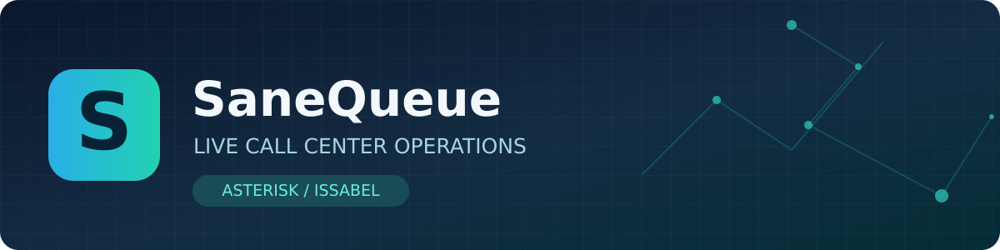

# SaneQueue — صانع | مانیتورینگ لحظه‌ای مرکز تماس

[English](README.md) | [نقشه امکانات](docs/LIVE_MONITORING_MATRIX.fa.md) | [راهنمای دسترسی Asterisk](docs/ASTERISK_ACCESS_GUIDE.fa.md) | [طرح AI](docs/AI_LIVE_COPILOT.fa.md) | [مشکل نسخه قدیمی](docs/WINDOWS_BETA3_GUIDE.fa.md)

**SaneQueue** یک نرم‌افزار فارسی/انگلیسی برای مشاهده و مدیریت زنده صف‌های Asterisk، Issabel و مراکز تماس است که با حفظ اعتبار و مجوز متن‌باز [QPanel](https://github.com/roramirez/qpanel) توسعه می‌یابد.

## امکانات هدف
- صف‌ها، تماس‌های منتظر، زمان انتظار، وضعیت و ظرفیت کارشناسان.
- هشدار ازدحام، کمبود نفر آماده، مدت Pause و اختلال ارتباط.
- نمای دیواری، رنگ‌بندی روشن/تیره، زبان فارسی راست‌چین و انگلیسی.
- کنترل‌های سرپرست: Pause/Resume، عضویت، اولویت تماس، شنود، نجوا و ورود به مکالمه (نیازمند آزمایش عملیاتی و مجوز محدود).
- نقش مدیر، سرپرست، کارشناس و مشاهده‌گر، جداسازی صف‌ها و ثبت عملیات.
- برنامهٔ توسعه: Trunk/Presence، انتقال تماس، Park، WebPhone و AI Copilot زنده.

**گزارش‌گیری تاریخی و Excel فعلاً در محدودهٔ توسعه نیستند.**

## وضعیت نسخه

- نسخهٔ جدید **2.0.0-beta.3** در بستهٔ آفلاین محلی آماده شده؛ **هنوز سورس کامل آن روی GitHub قرار نگرفته است**.
- نمایشی با دادهٔ ساختگی و غیرفعال بودن کنترل‌های واقعی.
- تست‌های ساختاری این بسته موفق‌اند؛ اتصال به AMI/Asterisk واقعی هنوز تست نشده است.
- سورس قدیمی‌تر GitHub و شاخهٔ `master` تغییر نکرده‌اند.

## چرا هنوز نسخه قدیمی را می‌بینم؟

پورت **8765** متعلق به نمونه قبلی است. ZIP جدید را در پوشهٔ تازه استخراج کرده و `RUN_DEMO_WINDOWS.bat` را اجرا کنید؛ سپس این نشانی را باز کنید:

`http://127.0.0.1:8766/operations`

و شماره نسخه را با `http://127.0.0.1:8766/__sanequeue__/build` بررسی کنید. راهنمای [تشخیص مشکلات ویندوز](docs/WINDOWS_BETA3_GUIDE.fa.md) را بخوانید.

## استفاده حرفه‌ای و امنیت

برای اتصال واقعی، از حساب AMI موقت **فقط خواندنی** داخل شبکهٔ خصوصی استفاده شود؛ بازکردن 5038 روی اینترنت یا ارسال رمز در گفتگو ممنوع است. کنترل فرمان‌ها باید ابتدا روی تماس آزمایشی و با سیاست‌های سازمانی تست شود.

## مشارکت و مجوز

این نرم‌افزار از QPanel با مجوز MIT مشتق شده است. تغییرات در [شاخه بازیابی](https://github.com/SaneHajiha/sanequeue/tree/work-recovery-2026-10-22) و [PR #1](https://github.com/SaneHajiha/sanequeue/pull/1) بررسی می‌شوند؛ هیچ‌کدام به‌معنی انتشار production نیستند.

توسعه‌دهنده: **صانع حاجیها** — مدیر و مشاور شبکه و فناوری اطلاعات · [وب‌سایت](https://sanehajiha.ir) · [لینکدین](https://www.linkedin.com/in/sane-hajiha-544948199).
