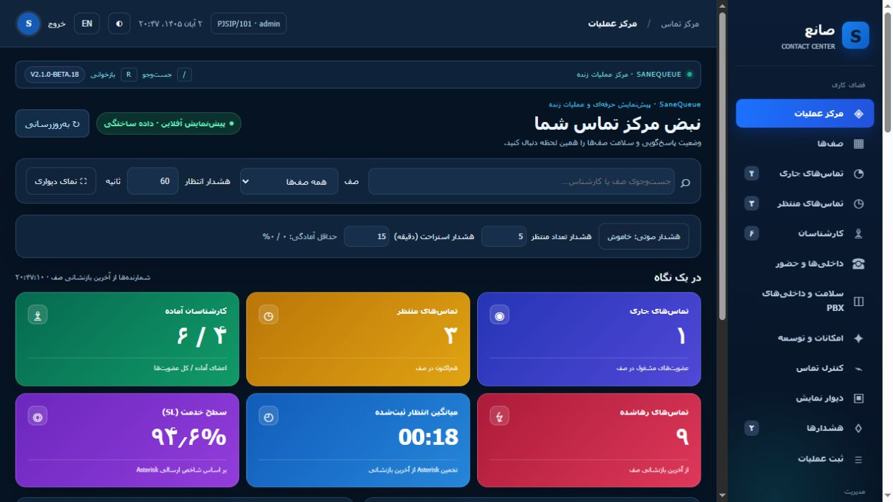

# صانع · SaneQueue

مانیتورینگ زندهٔ صف برای مراکز تماس مبتنی بر Asterisk، با مجوز MIT.

**نسخهٔ 2.1.0-beta.23 · [English](README.md)**

نصب‌کنندهٔ استاندارد با Collector پایدار اکنون داشبورد را به Redis و WebSocket احراز هویت‌شده متصل می‌کند. خواندن عادی وب اتصال AMI جدید ایجاد نمی‌کند. [راه‌اندازی فارسی](docs/REALTIME_DEPLOYMENT.fa.md)، [معماری](docs/REALTIME_ARCHITECTURE.fa.md)، [ممیزی جدید و امتیاز سخت‌گیرانه](docs/AUDIT_BETA23.md)، [ورود مدیر و بازیابی رمز](docs/ADMIN_ACCESS.fa.md). گزارش‌گیری فاز بعد است.



امکانات این نسخه شامل نمایش زنده صف‌ها، تماس‌های منتظر، وضعیت کارشناسان، سطح خدمت، فیلتر و جست‌وجو، پوسته روشن و تیره، نمای دیواری، نمودار زنده، کاربران و مجوزهای صف، حداقل آمادگی، دلایل توقف، ثبت عملیات، برنامه شیفت و دفترچه تلفن است.

توقف و ادامه، وزن کارشناس، عضویت پویا، اولویت و قطع تماس آزمایشی روی Asterisk 20.12 تأیید شده‌اند. شنود، نجوا و ورود به مکالمه از مسیر ChanSpy انجام می‌شوند؛ پذیرش فرمان AMI معادل تأیید صدا نیست و آزمون شنیداری در هر نصب لازم است. انتقال مستقیم و با مشورت، پارک/بازیابی و Pickup اکنون روی PBX آزمایشی و با تأیید کاربر آزموده شدند؛ این کنترل‌ها همچنان بتا و وابسته به نصب هستند. CRM، WebRTC، هوش مصنوعی و گزارش‌های تاریخی در این نسخه تحویل نشده‌اند. گزارش‌گیری فاز بعدی پروژه است.

[راه‌اندازی حالت پایدار](docs/REALTIME_DEPLOYMENT.fa.md) · [نصب پایه](docs/INSTALL.fa.md) · [راهنمای کاربری](docs/USER_GUIDE.fa.md) · [جدول امکانات](docs/FEATURES.md) · [سازگاری و بار سرور](docs/COMPATIBILITY.md) · [نتیجه آزمون‌ها](docs/VALIDATION.md)

```bash
git clone https://github.com/SaneHajiha/sanequeue.git
cd sanequeue
sudo bash scripts/install.sh
```

نصب‌کننده Python مستقل را آماده می‌کند، Redis خصوصی و دو حساب محدود AMI می‌سازد و Collector، وب و خواندن فهرست داخلی‌ها را راه‌اندازی می‌کند. رمز اولیه را خود نصب‌کننده از شما می‌پرسد؛ رمز پیش‌فرض مشترک وجود ندارد. صف‌ها و داخلی‌ها خودکار کشف می‌شوند و حساب‌های قبلی هنگام ارتقا حفظ می‌شوند. Asterisk راه‌اندازی مجدد نمی‌شود؛ فقط تنظیمات AMI بازخوانی می‌شوند.

هر ۱۷ منو راهنمای بازشوندهٔ فارسی/انگلیسی دارد. [راهنمای تصویری فارسی](docs/USER_GUIDE.fa.md) · [English manual](docs/USER_GUIDE.en.md). نقش، منوهای مجاز و عملیات مجاز هر صف مستقل کنترل می‌شوند. از دکمهٔ تصویر بالای پنل می‌توان نام، داخلی، عکس و رمز خود را تغییر داد؛ تغییر رمز یا داخلی نیازمند رمز فعلی است.

ارسال واقعی هشدار تلگرام و بله، دریافت RTCP تماس PJSIP و آزمون محدود ۱۰۰ تماس هم‌زمان Local انجام شده‌اند. این آزمون بار، تأیید ۱۰۰ تماس صوتی SIP/RTP نیست. نصب واقعی روی Rocky 8.10 و Asterisk 20.12 آزموده شده؛ همهٔ نسخه‌های ایزابل ۴/۵ و Asterisk ۱۶/۱۸ هنوز پذیرش عملی مستقل لازم دارند. [نتیجه و محدودیت‌های beta.23](docs/AUDIT_BETA23.md).

اعلان حقوقی کدهای اقتباس‌شده و کتابخانه‌های همراه در LICENSE و NOTICE محفوظ است.
