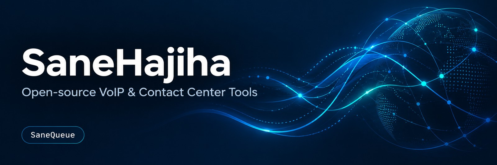
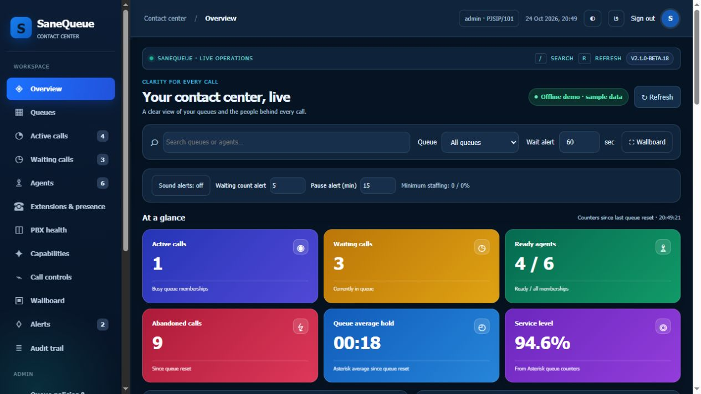

<p align="center"></p>

# SaneQueue

Persian and English live queue monitoring for Asterisk-based contact centers, built on [QPanel](https://github.com/roramirez/qpanel). MIT licensed.

**2.1.0-beta.18 · monitoring validation release · [راهنمای فارسی](README.fa.md)**



## What you can use

- Live queues, waiting callers, agent availability, queue counters and service level.
- Persian RTL / English LTR, local fonts, dark/light appearance, search, queue filters, wallboard and browser-observed live charts.
- Scoped accounts, supervisor phones, per-queue permissions, pause reasons and minimum staffing rules.
- Staged pause/resume, penalty, dynamic membership, caller priority and hangup controls with CSRF checks and audit records.
- SIP/PJSIP endpoint and registration inventory, active channel and parking inventory, capability detection.
- Live call journey events, threshold alerts, optional Bale notifications, queue directory and shift planning with overlap validation.
- Shared five-second AMI snapshots, bounded timeouts and failure backoff. Viewing the panel does not create an AMI connection per browser request.

Listen/whisper/barge requests use ChanSpy and a configured supervisor extension. AMI acceptance is **not audio confirmation**. These controls remain beta and require a manual audio acceptance test on each installation. Transfer, pickup, parking controls, CRM, WebRTC, AI and historical reports are **not delivered features**. See the [feature matrix](docs/FEATURES.md).

## Install and operate

[Installation](docs/INSTALL.md) · [Compatibility and performance](docs/COMPATIBILITY.md) · [User guide](docs/USER_GUIDE.md) · [Validation evidence](docs/VALIDATION.md) · [Changelog](CHANGELOG.md) · [Security](SECURITY.md) · [Contributing](CONTRIBUTING.md)

```bash
git clone https://github.com/SaneHajiha/sanequeue.git
cd sanequeue
sudo env PYTHON=python3.11 bash scripts/install.sh
```

The installer requires an isolated Python 3.10–3.12 runtime. Never replace Issabel's system Python. It creates a dedicated OS user, asks for AMI credentials and a dashboard password, stores only the password hash, and binds the service to localhost. Review the install guide before starting it. No dialplan or SIP endpoint configuration is changed.

## Verified scope

224 pytest tests passed locally on Python 3.11. Live monitoring and queue controls were exercised on a test PBX running Rocky Linux 8.10 and Asterisk 20.12.0. Asterisk 16/18 event variants are fixture-tested; Issabel 4/5 and all customer installations are not universally certified. Docker configuration is supplied but has not been built in this validation environment. This release is beta, with explicit remaining acceptance work.

Screenshots use synthetic data. Historical notes from earlier previews remain under `docs/` and root release notes for provenance; this README and the beta.18 validation guide describe the current release.

## Attribution

Copyright and licenses of QPanel and bundled libraries are preserved in [LICENSE](LICENSE) and [NOTICE](NOTICE). SaneQueue is independent of Issabel, Asterisk, FOP2 and VoiPing. No proprietary assets or source code from those products are included.
