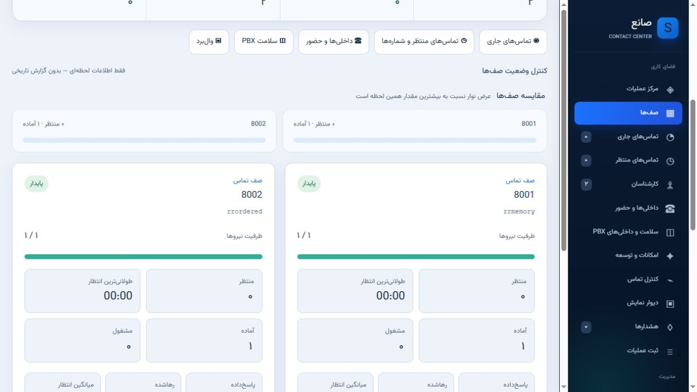

# Strict audit · beta.21 · 2026-10-25

This is an engineering assessment, not a zero-defect or production certification. [راهنمای راه‌اندازی فارسی](REALTIME_DEPLOYMENT.fa.md) · [Deployment](REALTIME_DEPLOYMENT.md).

## Critical review and corrections / نقد و اصلاح

| Finding | Correction and evidence |
|---|---|
| Ordinary HTTP reads could perform channel/inventory AMI probes | Redis-only projections for queues, journeys, channels and periodic inventory; missing/stale Redis fails closed |
| Viewer count drove PBX collection work | Independent elected collector; 100 HTTP reads at concurrency 20 and 20 WebSockets/60 snapshots produced zero additional web AMI collections and zero collector resyncs during each measured window |
| WebSocket session could survive logout | Shared hashed-token revocation registry; existing socket closed with 4401 after actual HTTP logout |
| Call control transport and read identity shared privileges | Dedicated loopback collector identity verified unable to Hangup/Originate/QueuePause/Command/BlindTransfer/Park; separate supervisor transport |
| Tuple response caused HTTP 500 after a successful pause | Normalize executor responses at the Flask boundary; regression test plus real pause/resume retest |
| Local halves and already bridged device legs lost queue provenance | Traverse exact Local `;1/;2` pairs and observed bridge edges; recover explicit Queue application membership from CoreShowChannel; never infer scope from Linkedid alone |
| Ringing device was not yet associated when AgentCalled arrived | AgentCalled establishes queue provenance without asserting that the call was answered; live Pickup retest passed |
| Transferred supervisor phone disappeared from target list | Include exact scoped SIP/PJSIP legs even when not queue members; exclude cross-scope channels; actual transfers retested |
| Park could select a two-leg subset of a larger conference | Require exactly two authorized bridge participants from the complete observed state |
| Sent RTCP sample erased a recent received RTT | Keep directions separately; prefer a received sample up to 30 seconds; no invented MOS or millisecond jitter |
| Late transport timeout could overwrite an observed command result | Terminal command states are fenced against later updates |
| Capacity reservations were only process-local | SQLite WAL/BEGIN IMMEDIATE serializes reservations; concurrent independent-store test |
| Bale cooldown/outbox state was volatile | Durable, leased, bounded outbox, retry/backoff and restart-safe cooldown; no live send claim without credentials |
| Light-theme shortcuts, presence and feature cards had unreadable colors | Shared theme contract and explicit component colors; removed completed-card opacity; repeated screenshot and computed-style review |
| Tiny captions and repeated filter chrome reduced usability | 12px minimum audited captions, larger controls, keyboard focus, 44px narrow-screen controls; hide monitoring filters in management views |
| Live rerenders destroyed keyboard focus and modal return targets | Preserve dataset-addressed button focus; pause underlying rerender while a native dialog is open; Escape return-focus checked in the browser |
| Server/browser clock drift distorted stale detection | Freshness timer uses local monotonic receipt time; PBX observation timestamp remains separate |

## Live test PBX / آزمون واقعی

Automated final suites: Windows Python 3.11: **276 passed, 2 Redis-dependent skips, 79 subtests passed**; Linux Python 3.11 with actual private Redis: **278 passed, 79 subtests passed**, zero failures. CI additionally exercises Python 3.10 and 3.12. Historical release snapshots are explicitly excluded and retained under `tests/historical`; current regression coverage is run by default through `pytest.ini`.

Rocky Linux 8.10, Asterisk 20.12.0; two visible queues, Local queue members and PJSIP test phones. The existing stable application remained available on port 5000 during review on 18896. Asterisk was not restarted and no SIP endpoint or dialplan configuration was rewritten.

| Test | Observed result |
|---|---|
| Pause/resume, penalty 1 → 0, dynamic add/remove | HTTP path accepted; collector observed actual effects; original settings restored |
| Park/retrieve | Parked in default lot, slot 71; phone 300 rang and answered; parked entry disappeared and scoped bridge to caller survived; user confirmed |
| Blind transfer 300 → 100 | Phone 100 rang and call continued; user confirmed |
| Attended transfer 100 → 300 | Consultation answered; source 100 hung up; caller remained connected to 300; user confirmed |
| Pickup ringing 100 from 300 | First expired target was safely refused; next valid ringing target was picked up; user confirmed ringing stopped on 100 and call moved to 300 |
| Listen/whisper/barge from prior beta | Supervisor received audio from 100; full outbound/isolation audio remains unverified because 200/300 lacked microphones |
| Collector stopped/restarted | API became 503/stale and recovered; stable dashboard stayed available |
| HTTP load | 100 requests, concurrency 20, all 200, measured p95 182 ms; no extra collection/resync in the window |
| WebSocket load | 20 sockets, 60 snapshots in 4.419 s; no extra collection/resync in the window |
| Logout | Existing real WebSocket invalidated with 4401 |

These small test-server measurements are not a high-call-volume capacity certification. An accepted command never establishes audio quality. Cancel-attended-transfer, click-to-call, RTCP numeric parsing and adverse cases have automated coverage; they do not all have live telephone acceptance in this run. Some advanced command outcomes can remain `unknown` even after external/manual success; no automatic retry is attempted.

## Visual verification / بررسی بصری

Product Design Audit was used on the existing product. Sixteen views were traversed in Persian at 1280px and 492px widths, with light/dark theme and English LTR checks. The iterative DOM audit detected no remaining non-gradient text contrast failures or page overflow outside intended scrolling tables in the final inspected states. This is not a complete WCAG certification: gradient backgrounds, pseudo-elements, color-only meaning, screen-reader workflows, all phone viewports, open dialogs and unobserved live states require additional assessment. Screenshots were inspected separately. The supplied user screenshot was the starting issue report.

## Strict score / امتیاز سخت‌گیرانه

| Area | Before | Current | Why not 10 |
|---|---:|---:|---|
| Monitoring architecture | 5/10 | 8/10 | Single-node gateway, bounded 100-socket implementation, limited live scale evidence |
| Call controls | 6/10 | 8/10 | More real actions accepted; complete audio isolation and every driver/version still need acceptance |
| Security | 6/10 | 7/10 | Scoped APIs, separate AMI identity, revocation; full independent penetration review and operational TLS rollout remain |
| UI usability | 5/10 | 8/10 | Repeated theme/layout fixes; no full accessibility certification |
| Overall enterprise readiness | 5/10 | 7/10 | Actual Issabel 4/5 + Asterisk 16/18 VM matrix, long-running call load, HA and recovery drills remain |

نسخهٔ فعلی بتای قابل‌آزمایش است. صفر شکست در تست‌های اجراشده به معنی صفر باگ ممکن نیست. امتیاز کلی ۷ از ۱۰ است؛ برای ۱۰ دادن، شواهد سازگاری واقعی، بار تماس طولانی و پذیرش کامل صوت لازم است.

Historical reporting remains the next phase. WebRTC and AI are optional/deferred by user choice; no simulated voice/model integration is presented as working. PJSIP/parking inventory requiring stronger AMI write privileges remains explicitly partial/unavailable under the read identity. Copyright and license notices remain intact; product-facing branding is SaneQueue.

Protocol references: [Asterisk Park](https://docs.asterisk.org/Asterisk_20_Documentation/API_Documentation/AMI_Actions/Park/), [BlindTransfer event](https://docs.asterisk.org/Asterisk_20_Documentation/API_Documentation/AMI_Events/BlindTransfer/), [AttendedTransfer event](https://docs.asterisk.org/Asterisk_20_Documentation/API_Documentation/AMI_Events/AttendedTransfer/). Local live CLI capability checks take precedence over assuming every version grants the same actions.
