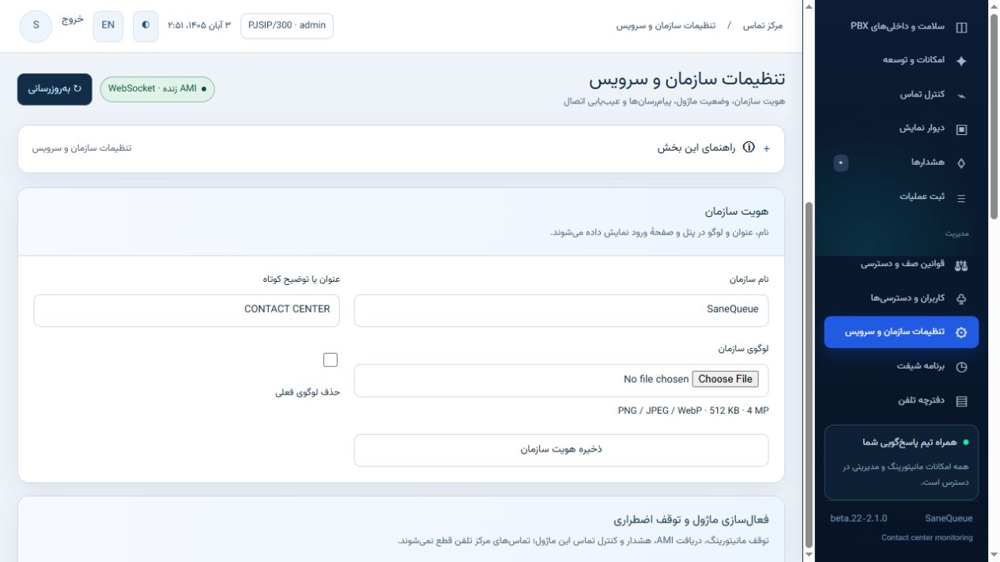
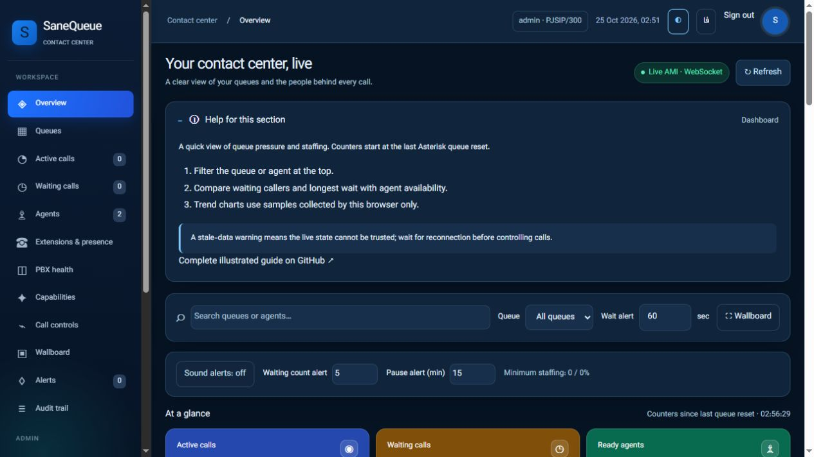
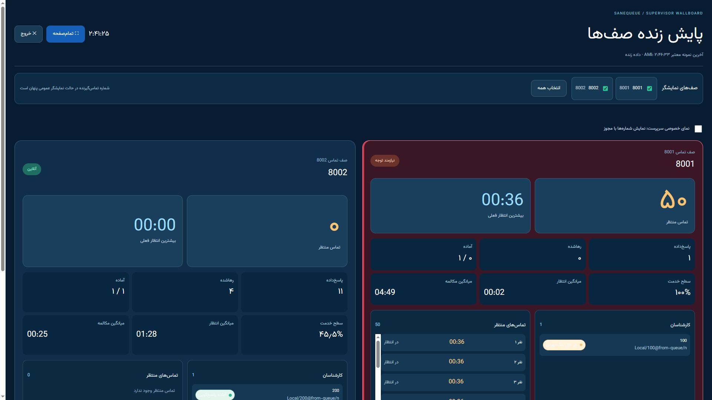

# beta.22 acceptance and strict review · 2026-10-25

**Disposition: suitable for a controlled installation pilot with immediate disable/rollback available. This is not an all-platform production certification.**

The release includes automatic local deployment, a persistent AMI collector, Redis/WebSocket reads, scoped supervisor controls, role/menu/queue permissions, private Telegram/Bale settings, organization identity, personal profiles and contextual bilingual guidance. Historical reporting, a browser softphone, AI/STT and multi-tenant/high-availability operation are separate work, not active features hidden behind a “coming soon” control.

## Acceptance evidence

| Check | Result |
|---|---|
| Windows Python 3.11 | 296 passed, 4 platform/Redis skips, 79 subtests passed |
| Linux Python 3.11 + actual dedicated Redis DB | 300 passed, 84 subtests passed |
| JavaScript | operations.js, planning.js, organization.js syntax checked |
| Live account acceptance | Discovered PJSIP phones; rejected numeric SIP trunk assignment; queue scope, forbidden admin APIs, cross-queue pause rejection |
| Personal profile | Temporary account avatar, old-password verification, password change/relogin and ignored role-escalation input |
| Messaging | Actual Telegram and Bale destination delivery, plus an actual queue-threshold alert during Local load |
| RTCP | Two received PJSIP streams for queue 8001; observed RTT 30.6–40.4 ms; available loss reports 0%; missing report fields null |
| Module pause | API reads and controls fail closed; collector AMI session disappears; re-enable resynchronizes |
| Root emergency stop | All module services stopped/disabled; Asterisk MainPID unchanged and CLI responding; enable recovers |
| Organization | Saved identity appeared on login; image decode/reencode and permission boundaries tested |
| Installer | Real install/upgrade on laboratory PBX; private backup, no Asterisk restart; remove/reinstall acceptance recorded below |

Earlier live telephone acceptance covered pause/resume, penalty, dynamic membership, park/retrieve, blind and attended transfer, pickup, and supervisor connection/hearing agent audio in listen/whisper/barge. The user confirmed telephone results. Phones without microphones prevented complete whisper isolation and bidirectional barge audio acceptance. Do not infer those outcomes from AMI success.

## Final bounded Local-call test

Generator: **Local queue callers + Wait**, no external trunks and no RTP media generator. Six vCPUs, Rocky Linux 8.10, Asterisk 20.12.0. Stages 10/25/50/100 waiting calls; 100 HTTP requests at concurrency 20 per stage. Collector remained connected. Cleanup removed every generated leg; remaining generated legs: 0.

| At 100 waiting calls | Measurement |
|---|---|
| Total host CPU | 19.19% of six-vCPU capacity |
| Asterisk CPU | 50.4% of one core |
| Asterisk RSS | 149.16 MB |
| Web RSS | 78.75 MB |
| Collector RSS | 37.89 MB |
| HTTP p95 | 1.4563 seconds |
| HTTP errors | 0 |
| Additional web AMI collections | 0 |

[Machine-readable load evidence](benchmarks/beta22-local-queue-load.json) · [RTCP observation summary](benchmarks/beta22-rtcp-summary.json)

This measures queue/event/UI behavior under a bounded synthetic load. It does not measure 100 registered SIP endpoints, RTP transport, transcoding, recording, concurrent supervision, packet capture or audio gaps. Long-duration memory/retention soak and representative media load remain installation acceptance tasks.

## Defects found and corrected in this pass

1. Numeric trunk names incorrectly appeared as internal phones: classify generated definitions by endpoint type and internal context, export only sanitized inventory, and reject trunk assignments server-side.
2. Role names alone did not make menu scope clear: enforce role ceilings, queue/action grants and selected sections on APIs; render only authorized navigation.
3. Manual temporary queue gates obstructed managed deployments: managed RBAC authenticates each action and requires fresh scoped state; legacy lab gates remain a separate mode.
4. Threshold boundary and combinations were ambiguous: trigger at the configured value, independently enable count/time and choose any/all; durable per-provider cooldown/retry state.
5. Light-theme capacity bars remained five pixels wide despite percentages: remove the old fixed flex basis, add legend/counts and enlarge trend plots.
6. Fullscreen stale status and subset summaries were inconsistent: keep stale warning inside fullscreen and derive wallboard totals from its selected queues.
7. The active-call navigation badge included waiting calls: count only busy memberships, matching the active-call page definition.
8. Package VERSION differed from runtime version: align the release metadata.
9. Installer HTTP readiness had a startup race: bounded retries now wait for the gateway instead of treating early connection refusal as permanent failure.
10. Explicit emergency lifecycle was missing: reversible UI maintenance mode, root service disable/enable, service removal with retained private recovery data, bounded service stop times and unchanged PBX service.

## Strict score and release boundary

Engineering judgment for the **tested single-node monitoring pilot: 8.5/10**. Passing all defined tests is not evidence of every possible defect being absent. A 10/10 universal production claim would conceal untested deployment/media conditions.

Before production on another server: verify Issabel 4/5 package/bootstrap support, Asterisk 16/18/20 modules and privileges, site-specific contexts, SIP and PJSIP agent audio/control behavior, TLS/firewall, realistic RTP/recording/supervision concurrency, recovery and long-duration resource behavior. Local discovery currently recognizes the standard `from-internal` endpoint context; custom contexts require explicit adapter work. Standalone authentication is provided; native ACL/Smarty/SSO integration is not certified. No MOS or codec-clock conversion is invented when inputs are unavailable.

## فارسی

نسخه برای پایلوت کنترل‌شده با امکان غیرفعال‌سازی فوری آماده می‌شود. آزمون‌های تعریف‌شده بدون شکست‌اند؛ این عبارت به معنی «تمام باگ‌های ممکن صفر است» نیست. بار ۱۰۰ تماس Local و RTCP واقعی جدا آزموده شده‌اند؛ بار صوتی ۱۰۰ تماس، نسخه‌های نصب‌نشده و جهت کامل صدای نجوا/ورود هنوز در پذیرش هر سرور بررسی می‌شوند. نمرهٔ سخت‌گیرانه برای محدودهٔ آزموده‌شده ۸٫۵ از ۱۰ است.

## Removal/reinstallation and visual follow-up

Service removal/reinstallation passed after fixing the gateway-startup readiness race. Only the managed AMI block was removed, private accounts/configuration remained, reinstall succeeded, and Asterisk MainPID stayed unchanged. UI pause, root disable and re-enable also passed independently.

All 17 menu sections were traversed with contextual English help present and no server-error screen. Persian light and English dark help, user permissions, profile, organization settings and actual fullscreen wallboard were inspected. The new settings form was checked at a 492-pixel viewport with page width equal to viewport content width (477 pixels excluding scrollbar), without document overflow. This does not establish full accessibility or real-device certification.

## Independent review follow-up

[Coverage, verified fixes and the remaining external-review gate](INDEPENDENT_REVIEW_BETA22.md). The external reviewer did not extract the whole repository. Its confirmed session, branding, upload, phone and avatar findings were fixed with regression tests. In-house follow-up also added canonical identities, NAT-safe login budgets, serialized deletion, atomic runtime identity snapshots and policy-based alert audio. Windows follow-up passed 308 tests and 79 subtests before the additional legacy-session migration case; final CI identity is recorded in the pull request. The local registry currently supports at most 100 accounts and policies at most 100 queues; requests above the account limit are rejected before writing.
