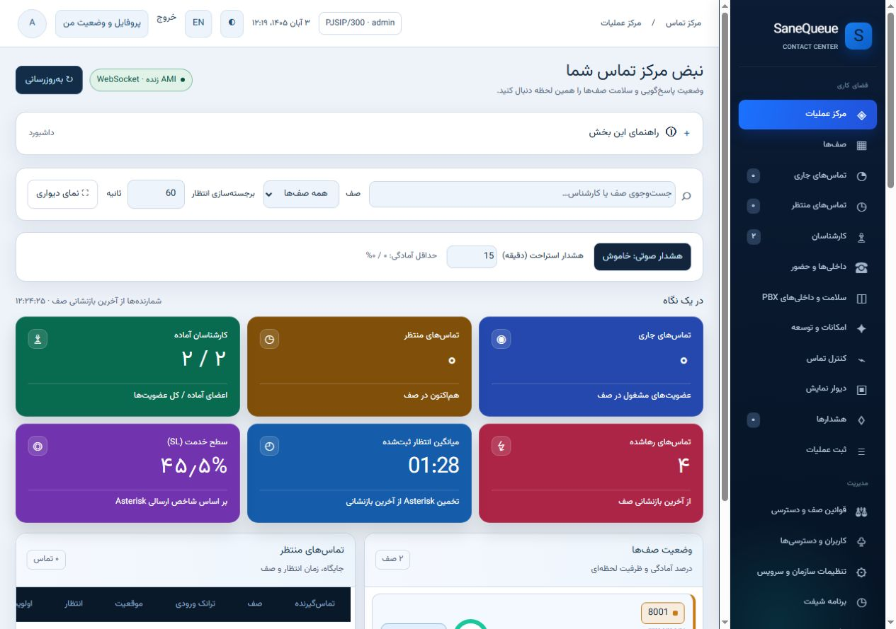
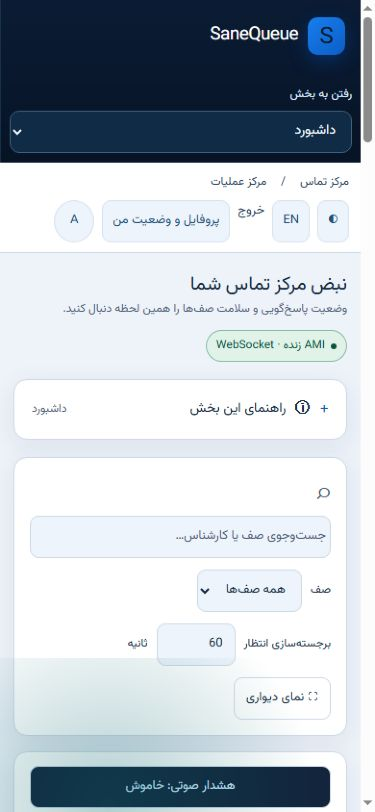

# beta.24 visual follow-up · 2026-10-25

این نسخه ادامهٔ beta.23 است. پس از بازیابی موقت ابزار تصویر، بررسی واقعی دو اشکالِ شبکهٔ دسکتاپ و بیرون‌زدگی نوار پروفایل موبایل را آشکار کرد؛ هر دو اصلاح شدند. هیچ ادعای «صفر باگ ممکن» یا سازگاری عملی تمام سرورها مطرح نیست.

## New evidence

- Actual in-app browser screenshots inspected in light and dark themes. White values on colored KPI cards and the dark wallboard summary are readable in the inspected views.
- At 1440 px, the agent panel now occupies the third desktop column; old global grid rules no longer push it below an empty column.
- Queue cards no longer reserve an unused fifth grid track. Queue identity, readiness ring and action fit inside the card, with metrics and graphics on defined rows.
- At 390 and 320 px, measured document width stays within the viewport (375/390 and 305/320 respectively; the difference is the scrollbar). The profile/avatar controls stay reachable. Individual data tables deliberately scroll inside their own containers.
- The eight supervisor totals remain inside the fullscreen stage and are visible in embedded fullscreen. Both toggle exit and Escape are covered by executed frontend behavior checks. Chrome's fullscreen stage exposed all eight totals in its accessibility tree, but subsequent screenshot/control timed out; native OS fullscreen certification is not claimed.
- The browser engine intermittently failed again. Final dark-theme layout, the full accessibility matrix and a fresh Gemini review are not independently signed off. The requested Gemini tab was attempted without sending any private server data; no new response was obtained.

The screenshot above was captured during the visual candidate review, before the version label was advanced to beta.24. It shows the same desktop layout corrections. Values are laboratory observations, not performance targets.

## Runtime and regression scope

Monitoring/control code retains the [beta.23 regression and live acceptance](AUDIT_BETA23.md): 326 local tests, 79 subtests, scoped controls on both queues, bounded daily activity and a 100-Local-caller test. The latter is not an RTP/audio-concurrency test. beta.23 CI passed on Python 3.10/3.11/3.12 with Redis; beta.24 publication repeats the same CI and JavaScript checks for this exact source.

The public beta.23 one-file installer was also executed successfully on the lab PBX, preserving accounts, rediscovery and the Asterisk process. beta.24 uses the same installation path with the new immutable tag.

Strict assessment: **8/10 for a controlled monitoring pilot**. Remaining acceptance is real media and long soak, target installation versions/dialplans, complete assistive-technology review and the outstanding independent review. Formal Codex Security scan output remains unavailable as documented in beta.23; no report or external approval is fabricated.

[English installation](INSTALL.md) · [نصب فارسی](INSTALL.fa.md) · [English manual](USER_GUIDE.en.md) · [راهنمای فارسی](USER_GUIDE.fa.md)
