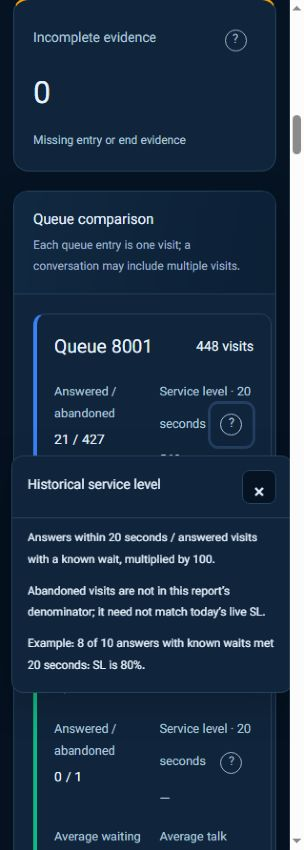

# Contextual metric and action help

Question-mark controls beside metrics and report headings open help for that exact concept. Hover or keyboard focus shows a short preview. Click/tap pins the full explanation; Close, Escape or an outside click dismisses it. Close/Escape restores trigger focus. Touch targets are 44px with a smaller visible circle.

Supported action buttons show their meaning on hover/focus; F1 pins the explanation without executing the action. Mobile users can also use the Help control in the quick-operations/control heading. Ordinary action clicks retain their existing behavior and confirmation flow. Shortcuts explicitly say that they open a view rather than immediately executing a call action.

Definitions distinguish queue abandonment from unanswered agent ringing attempts, queue visits from unique conversations, live versus historical service-level denominators, live versus historical waiting averages, queue-segment talk versus full AHT, segment hangup versus final conversation hangup, and unique duty versus summed membership time. Historical SL currently uses answers within 20 seconds divided by answered visits with known waiting times. The report average wait includes all known visit waits, including abandonment waits when available. Unknown evidence is never described as zero.

Abandonment and unanswered ringing are distinct source events; see the [technical queue-event reference](https://docs.asterisk.org/Operation/Logging/Queue-Logs/). Generic “missed calls” wording must identify its actual counting unit and cause.

## Implementation contract

- Keep FA/EN text consistent with panel language and actual source/period selection.
- Explain meaning, calculation, an example and relevant limitations. Never describe planned features as implemented.
- The helper is browser-local: no fetch, AMI, dialing, state changes, polling or third-party dependency.
- Map definitions explicitly to metrics and columns; never infer report meaning from a column’s ordinal position in a generic table.
- Popovers adapt to the viewport, use the existing theme, stay within a native dialog/fullscreen context when relevant, and close when navigating to another view.
- Preserve focus and descriptions across live rendering. Public wallboard layouts hide extra help icons.
- Registry: `qpanel/themes/qpanel/static/js/context-help.js`. Rendering integration: `operations.js` and `reports.js`. `data-help-key` annotates existing shortcuts without intercepting their action clicks.
