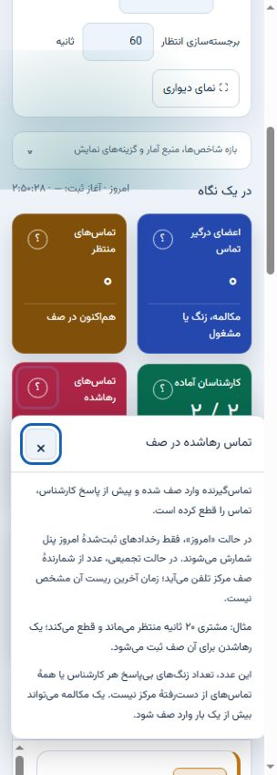

# راهنمای کنار شاخص‌ها و دکمه‌ها

علامت **؟** کنار شاخص یا عنوان جدول، معنی همان مورد را توضیح می‌دهد. با مکث ماوس یا فوکوس صفحه‌کلید، توضیح کوتاه دیده می‌شود. با کلیک یا لمس، توضیح کامل باز می‌ماند؛ ×، Escape یا کلیک بیرون، آن را می‌بندد. Escape و دکمهٔ بستن فوکوس را به دکمهٔ راهنما برمی‌گردانند. در موبایل، ناحیهٔ لمس ۴۴ پیکسل است؛ دایرهٔ ظاهری کوچک‌تر است تا صفحه شلوغ نشود.

روی دکمه‌های عملیاتی دارای راهنما، مکث یا فوکوس معنی عملیات را نشان می‌دهد؛ **F1** توضیح کامل را باز می‌کند و هیچ عملیاتی انجام نمی‌دهد. برای موبایل، «راهنما» در عنوان عملیات سریع و مرکز کنترل هم مرجع این دکمه‌هاست. کلیک خودِ دکمهٔ عملیات همچنان جریان اصلی و تأیید آن را دارد؛ علامت سؤال جای اجرای عملیات نیست.

## معنی عددها

| عنوان | معنی و محدودیت |
|---|---|
| رهاشده در گزارش | تماس‌گیرنده پیش از پاسخ، صف را ترک و تماس را قطع کرده است؛ رخداد ABANDON مبنای گزارش است. خروج با کلید، پایان مهلت و خروج از صف خالی نتیجه‌های جداگانه‌اند. |
| زنگ بی‌پاسخ کارشناس | یک تلاش زنگ‌زدنِ بی‌پاسخ است. ممکن است مشتری در صف بماند و کارشناس دیگری پاسخ بدهد؛ با رهاشدن مشتری یکی نیست. این واژه نباید جای تعداد کل تماس‌های از دست‌رفته استفاده شود. |
| شمارندهٔ تجمیعی رهاشده | عدد ارسالی مرکز تلفن است؛ زمان شروع/ریست و طبقه‌بندی آن را بدون شواهد با گزارش رخداد پنل یکسان فرض نکنید. |
| مراجعه به صف | هر بار ورود به صف؛ یک مکالمه ممکن است چند مراجعه داشته باشد. |
| پاسخ‌داده | مراجعه‌ای دارای شواهد پاسخ؛ انتقال بعدی پاسخ قبلی را حذف نمی‌کند. |
| پوشش ناقص | شواهد شروع یا پایان کم است؛ به معنی تماس ناموفق یا مقدار صفر نیست. |
| میانگین انتظار زندهٔ امروز | زمان‌های ثبت‌شدهٔ انتظار پاسخ‌ها در پوشش امروز؛ با بیشترین انتظار فعلی فرق دارد. |
| میانگین انتظار گزارش | میانگین انتظارهای معلومِ مراجعه‌ها، از جمله رهاشده اگر انتظارش ثبت شده باشد. |
| سطح خدمت زندهٔ امروز | پاسخ‌های داخل آستانه ÷ مجموع پاسخ‌داده و رهاشدهٔ ثبت‌شده. |
| سطح خدمت گزارش | پاسخ حداکثر ۲۰ ثانیه ÷ پاسخ‌های دارای انتظار معلوم؛ با فرمول زنده یکسان نیست. |
| میانگین مکالمهٔ صف | میانگین زمان‌های معلومِ همان بخش صف؛ AHT کامل شامل کار پس از تماس نیست. |
| قطع‌کننده | قطع‌کنندهٔ بخش صف؛ پس از انتقال، قطع‌کنندهٔ نهایی کل مکالمه بدون شواهد مستقل نامعلوم است. |
| کارکرد یکتا | اجتماع بازه‌های مشاهده‌شده در صف‌های مجاز؛ هم‌زمانی عضویت‌ها دوبار جمع نمی‌شود. |
| تماس حین توقف | شروع بخش CDR داخل توقف مشاهده‌شده بوده؛ مدت آن برای کل بخش است و ممکن است از پایان توقف عبور کند. |

منطق گزارش از کد محاسبات محلی پنل پیروی می‌کند. برای تمایز رخداد رهاشدن و تلاش زنگ بی‌پاسخ، [مرجع فنی رخدادهای صف](https://docs.asterisk.org/Operation/Logging/Queue-Logs/) نیز بررسی شده است. نام «از دست‌رفته» به‌تنهایی مبهم است؛ همیشه علت و واحد شمارش را مشخص کنید.

## قرارداد طراحی و نگهداری

- تعریف‌ها فارسی و انگلیسی و متناسب با زبان پنل‌اند. تعریف وابسته به منبع، مثل شمارندهٔ تجمیعی، باید منبع انتخاب‌شده را در نظر بگیرد.
- متن راهنما باید تعریف، روش شمارش، مثال و محدودیت مرتبط داشته باشد؛ نباید قابلیت برنامه‌ریزی‌شده را به‌عنوان قابلیت آماده معرفی کند.
- راهنما فقط در مرورگر اجرا می‌شود: درخواست شبکه، اتصال AMI، شماره‌گیری، تغییر وضعیت و تایمرِ پایش دوره‌ای ندارد.
- جدول‌های عمومی بر اساس شمارهٔ ستون، تعریف حدسی نمی‌گیرند؛ اتصال هر تعریف به ستون باید صریح باشد.
- در دیوار نمایش عمومی، آیکون‌های اضافهٔ راهنما پنهان می‌شوند تا نمایش مدیریتی شلوغ نشود.
- محل تعریف‌ها: `qpanel/themes/qpanel/static/js/context-help.js`. اتصال شاخص‌ها در `operations.js` و `reports.js` و اتصال میانبرها با `data-help-key` است. هر دکمه یا شاخص جدید باید تعریف درست و اتصال صریح خودش را داشته باشد.
