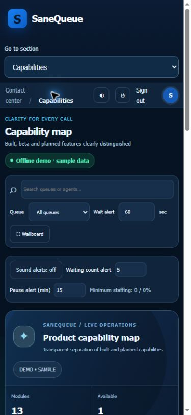

# Product Design audit follow-up · 2026-10-24

Scope: find queue state, discover capabilities and reach supervisor controls on a small screen. Evidence was captured during this audit; no PBX write action was performed.

| Step | Health and finding |
|---|---|
| 1. Capability map | Fixed: 13 listed modules previously had stale status totals adding to 12. Counts now derive from the catalogue: 1 available, 7 beta, 5 planned, localized per language. |
| 2. Queue overview | Usable: connection state and counter scope are explained. Secondary copy remains dense on small screens. |
| 3. Control hub | Clear locked state and target requirement; controls lead to scoped flows. No audio or PBX command was retested for this UI patch. |
| 4. Mobile navigation | Improved: a labeled native section selector replaces horizontal navigation below 760px. All 17 administrator views opened and selection stayed synchronized; options derive from the role's rendered menu. |

Checked Persian/English and 390×844 Chrome viewport. The selector is 44px high; document width and scroll width were both 375px. Desktop navigation remains available above the breakpoint. The existing 224-test suite and JS checks are used for regression validation.

Screenshots and DOM checks do not establish full WCAG compliance. Screen-reader behavior, 200% zoom, gradient contrast in every state and real-device testing remain acceptance work. Secondary text density should be addressed through further measured typography work.

فارسی: جمع وضعیت قابلیت‌ها اصلاح شد و در صفحه کوچک، انتخاب مستقیم تمام بخش‌های مجاز جای نوار افقی طولانی را گرفت. هر ۱۷ بخش مدیر و هر دو زبان بررسی شدند. این گزارش ادعای تأیید کامل دسترس‌پذیری یا همه دستگاه‌ها ندارد.
