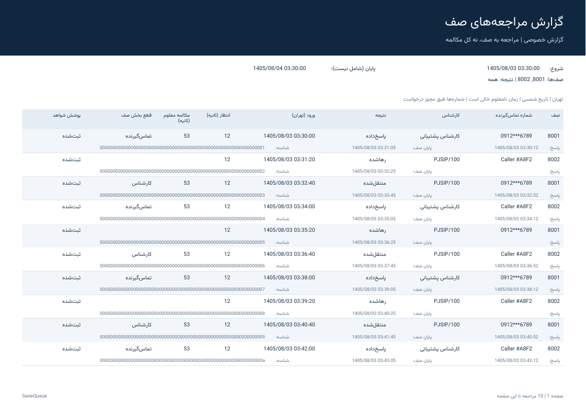
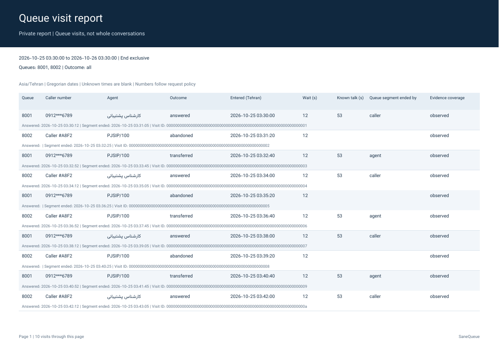

# خروجی PDF فارسی و انگلیسی / Persian and English PDF exports

PDF واقعی در کارگر پس‌زمینهٔ خروجی ساخته می‌شود. از منوی **گزارش‌ها → خروجی‌های پس‌زمینه**، بازه، صف‌ها، نتیجه و زبان را انتخاب کنید؛ قالب **PDF** را بزنید و درخواست را ثبت کنید. پس از وضعیت «تکمیل‌شده»، فایل را دانلود کنید. این خروجی با چاپ مرورگر ساخته نمی‌شود.

قالب PDF در گزارش ذخیره‌شده و برنامهٔ زمان‌بندی نیز قابل انتخاب است. مقصد تحویل همان پنل است؛ فایل خودکار به پیام‌رسان یا ایمیل فرستاده نمی‌شود. زمان‌بندی، مجوز و سیاست نگهداری عمومی خروجی‌ها تغییر نمی‌کند.



## خواندن گزارش

- هر ردیف، یک **مراجعه به صف** است؛ زمان مکالمهٔ شناخته‌شده، قطعهٔ صف را نشان می‌دهد و ادعای کل مکالمه پس از انتقال نیست.
- هر ۱۲ فیلد قرارداد خروجی وجود دارد: صف، شماره، کارشناس، نتیجه، ورود، پاسخ، پایان قطعه، انتظار، مکالمهٔ شناخته‌شده، قطع‌کنندهٔ قطعه، پوشش شواهد و شناسهٔ مراجعه. پاسخ، پایان و شناسه در سطر دوم هر ردیف هستند.
- سربرگ بازه و فیلترها را در هر صفحه تکرار می‌کند. شروع شامل و پایان **شامل نیست**. منطقهٔ زمانی تهران است؛ زبان فارسی تاریخ شمسی و انگلیسی تاریخ میلادی دارد. زمان نامعلوم خالی می‌ماند.
- شماره‌ها با همان سیاست دسترسی ثبت‌شدهٔ درخواست نمایش داده می‌شوند؛ ساخت و دانلود مجدداً مجوز فعلی را بررسی می‌کنند. فایل‌ها خصوصی هستند و URL عمومی ندارند.

## سقف‌ها و خطاها

برای مصرف محدود حافظه، PDF حداکثر **۱۰۰۰ ردیف، ۱۰۰ صفحه و ۸ MiB** دارد. خواندن منبع در صفحه‌های حداکثر ۲۰۰ ردیف و با تراکنش کوتاه انجام می‌شود؛ PDF از snapshot ثابت استفاده می‌کند. ReportLab اشیای PDF را تا ذخیرهٔ نهایی نگه می‌دارد، بنابراین این قالب عمداً سقف کمتری از CSV/XLSX دارد.

عبور از سقف، متن بیش از ظرفیت صفحه یا نبود وابستگی/فونت، خطای روشن ایجاد می‌کند؛ فایل ناقص یا بریده‌شده برای دانلود منتشر نمی‌شود. برای بازهٔ بزرگ‌تر CSV/XLSX یا بازهٔ کوچک‌تر را انتخاب کنید. لغو، قطع مجوز و کنترل بار در مرز صفحه و پیش از انتشار بررسی می‌شوند. این رفتار تضمین بار صفر یا تأیید همهٔ سرورهای واقعی نیست.

## نصب و عیب‌یابی

در همان محیط Python کارگر خروجی، وابستگی‌های اختیاری گزارش‌گیری را نصب کنید:

```sh
python -m pip install -r requirements/reporting.txt
```

نسخه‌های آزموده‌شده: `reportlab==4.4.9`، `arabic-reshaper==3.0.0` و `python-bidi==0.4.2`. فونت TTF در `assets/fonts/Vazirmatn-Regular.ttf` همراه پروژه است و با مجوز OFL توزیع می‌شود؛ [منبع و مجوز فونت](../assets/fonts/README.md). زمان اجرا فونت، تصویر، HTML یا URL خارجی دریافت نمی‌شود. نبود کتابخانه‌ها با `pdf_dependency_unavailable` و نبود/خرابی فونت با `pdf_font_unavailable` گزارش می‌شود. نصب وابستگی و فایل فونت را بررسی و درخواست تازه ایجاد کنید.

## English guide

Choose the date range, queues, outcome and language under **Reports → Background exports**, select **PDF**, submit, then download after completion. Saved reports and schedules accept PDF as well. Delivery remains in-app. This is a private background-worker PDF, not browser Print.



Each row represents one queue visit, not a complete transferred conversation. All twelve export fields are retained; answer time, segment end and visit ID appear on the second line. Each page repeats the frozen filters and half-open period `[start, end)`. Times use `Asia/Tehran`; Persian reports use Persian dates and English reports use Gregorian dates. Unknown values stay blank. Number masking follows the immutable request policy, with current authorization rechecked during generation and download.

PDF is limited to **1,000 rows, 100 pages and 8 MiB**. Source pages contain at most 200 rows, read through short transactions from the fixed snapshot. ReportLab retains document objects until final serialization, so PDF has deliberately lower limits than CSV/XLSX. Limits, unavailable dependencies or fields that cannot fit fail explicitly; no silently truncated or incomplete PDF is published. Use a narrower period or CSV/XLSX for larger exports. Cancellation and fresh authorization are fenced at page boundaries and before publication.

Install `requirements/reporting.txt` in the export worker's Python environment. The bundled TTF font is licensed under OFL; no runtime asset downloads, HTML rendering, subprocess converter or browser is involved. The rendered examples contain synthetic identifiers and masked numbers only. Validation covers pagination, font embedding, shaping, snapshot masking, limits, cancellation, permission revocation, publish-crash recovery and the authenticated PDF download MIME type. Broader production compatibility still requires the project's deployment and load tests.
