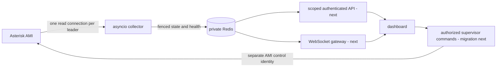

# SaneQueue real-time architecture

Status: collector pilot, 2026-10-24. This document describes implemented boundaries and the remaining migration, not a production certification. The installed beta.19 web application still uses its legacy snapshot adapter and separate journey listener. The new collector has been tested independently against the test PBX; it is not silently enabled for existing installs.

## Stack and process boundaries

Retain Python 3.10–3.12 and the working Flask application during migration. Use `asyncio` for the read-only collector, Redis for expiring shared state and leader fencing, an authenticated ASGI WebSocket gateway for the next phase, and PostgreSQL for the future application event/report database. Existing MariaDB CDR remains read-only. SQLite remains appropriate for a single-node pilot, not shared high-availability state.

```text
sanequeue/
  realtime/                 # IMPLEMENTED: independent of Flask and legacy imports
    protocol.py             # bounded AMI framing, one reader, ActionID correlation
    state.py                # queue members, waiting entries, channel legs, bridges
    collector.py            # leader session, heartbeat, reconnect, reconcile
    store.py                # Redis lease, fenced publish, TTL, stale detection
    config.py               # private configuration, verified TLS option
    __main__.py             # daemon and sanitized Redis-only status CLI
  api/                      # NEXT: authenticated read API and scoped projections
  actions/                  # NEXT: separate control identity, command lifecycle
  gateway/                  # NEXT: authenticated WebSocket push and backpressure
  history/                  # LATER: queue_log/CDR import and reporting
qpanel/                     # existing application; staged replacement, legal lineage retained
deploy/sanequeue-collector.service
samples/collector.ini.example
requirements/collector.txt
tests/test_realtime_engine.py
tests/test_realtime_redis.py
```

Only `realtime/` is the new implementation in this phase. The proposed directories marked NEXT/LATER are not empty pretend modules. Existing product menus remain available while their internals migrate.



## Implemented collector guarantees

- One elected leader per `pbx_id`; standby processes do not connect to AMI. A Lua ownership check fences every state publication. Losing renewal cancels connection/login as well as an established session. This limits duplicates during network partitions; it cannot provide an instantaneous physical singleton across arbitrary process freezes.
- A single connection carries Login, QueueStatus, optional CoreShowChannels and Ping. Its encoder rejects all other actions and CR/LF/NUL injection. Use a genuinely read-only AMI identity as a second boundary. The live pilot reused the existing private identity; production identity separation has not been deployed.
- QueueStatus/CoreShowChannels run on startup, reconnect and reconciliation (default 120 seconds), not on viewer requests. Ping is default 10 seconds. Reload requests a resync with a five-second minimum interval.
- Events arriving during snapshots enter a bounded journal. QueueParams sequence barriers avoid replaying aggregate completions already represented by that response. AMI snapshots are not atomic transactions; `snapshot_atomic=false` remains explicit and periodic reconciliation is required.
- Reconnect uses exponential backoff with jitter, capped at 30 seconds. All request futures settle on timeout/disconnect. Transport cleanup is bounded. Event/frame/state/journal/payload budgets fail closed and resynchronize instead of allocating indefinitely.
- Publications coalesce at one second by default. Lease 15 seconds, health TTL 15 seconds, state TTL 30 seconds. The publisher refreshes health even when state has not changed. A generation mismatch, missing state, incomplete sync or missing health is stale. API/gateway consumers must fail closed when Redis is unavailable; they must never fall back to AMI polling.
- Redis change notifications carry generation/revision only. Pub/Sub is not a durable event log: consumers must read the latest full snapshot after reconnect or missed revisions.

## Asterisk edge cases and KPI contracts

`QueueCallerLeave` removes a waiting entry, not the channel. Only Hangup ends that channel leg; another leg may survive transfer. Uniqueid identifies a leg; Linkedid is an association, not a universally reliable business-call ID. Local members and actual SIP/PJSIP channels remain distinct. Bridge switches clean old membership; late leave events cannot detach a newer bridge. Rename replaces the channel index. Ring-no-answer is not abandonment. Re-entry into the same queue starts a fresh counter episode even when Uniqueid is reused.

Member device activity, paused state and ready state are separate. `InCall=1` is not overwritten by AgentCalled. ONHOLD has priority over InCall in presentation. Wrap-up expires without needing another AMI event, but only when LastCall and Wrapuptime exist. Unknown values stay unknown. LastCall, pause and observed-state timestamps are different concepts.

QueueParams SLA/performance, Holdtime and TalkTime are PBX summaries at their snapshot time; incremental completion counts do not make those averages current. AgentComplete HoldTime is queue waiting time, not time spent placing an answered call on hold. The new engine does not invent AHT, ASA/AWT, abandonment denominator or historical completeness. Accurate windowed metrics require the later queue_log event ledger, an explicit short-abandon policy and timezone. Active `held_since` is observational and is not a cumulative hold metric.

CoreShowChannels can inventory active legs but does not reconstruct every bridge or answered call's originating queue after reconnect. `initial_call_scope_complete=false` and `history_complete=false` are intentional. Unattributed legs must remain hidden from scoped users; never guess permissions from caller number, extension prefixes or Linkedid alone. The collector's entire Redis payload is private, not a browser response.

## Next migration gates

1. Replace all ordinary dashboard reads and the separate journey listener with Redis projections; ensure old import-time backend connections and optional channel probes are also disabled in this mode. Keep legacy mode explicit for rollback. No silent fallback on failure.
2. Apply queue/action scope server-side before serialization, including dictionary keys, IDs, caller numbers, free-form fields and channel associations. Test viewer/agent/supervisor/admin, access revocation and expired sessions. Authenticate WebSocket upgrades, validate Origin, limit frame/subscription rate and re-check scope on every update.
3. Migrate controls to a separate AMI identity and a durable command ledger: pending → confirmed/rejected/unknown. AMI accepted does not prove device state or audio. Revalidate target ownership against fresh state, serialize staffing reservations across processes and reconcile external PBX changes. App policy cannot prevent manual PBX commands without PBX-side enforcement.
4. WebSocket full snapshot plus revision/generation contract; coalesce slow clients and disconnect rather than keep unbounded per-viewer queues. Existing frontend polling remains until this gate passes. No WebSocket feature is claimed by the collector release.
5. Reporting and durable alert outbox follow monitoring. Issabel SSO requires validated server-side session integration, not a trusted cookie or HTTP header.

## Pilot installation and rollback

Do not replace system Python or restart Asterisk. Install the collector's dependencies into a dedicated virtual environment (or the matching application venv), copy the private example to `/etc/sanequeue/collector.ini`, and provide a private authenticated Redis endpoint. Set config ownership `root:sanequeue`, mode `0640`. Never expose Redis or plain AMI to the public network. For remote AMI configure verified TLS or a private tunnel. The example does not create an AMI account or Redis server.

```bash
python -m pip install -r requirements/collector.txt
python -m sanequeue.realtime --config /etc/sanequeue/collector.ini
python -m sanequeue.realtime --config /etc/sanequeue/collector.ini --status
```

Review the service template paths before installing it. Stop the collector service to roll back this pilot; the legacy web service does not depend on it yet. The live validation used an isolated Redis on loopback port 16379, temporary credentials and two shadow collectors. Both collectors and temporary Redis were stopped afterward. Installing the distribution Redis package did not enable its service.

Cancellation-race context: [CPython issue 86296](https://github.com/python/cpython/issues/86296). The collector uses an explicit deadline helper and regression tests rather than depending on race-sensitive `wait_for` behavior across supported Python versions.

Sources: [Asterisk QueueMemberStatus](https://docs.asterisk.org/Asterisk_21_Documentation/API_Documentation/AMI_Events/QueueMemberStatus/), [AMI event reference](https://docs.asterisk.org/Latest_API/API_Documentation/AMI_Events/), [Redis expiration semantics](https://redis.io/docs/latest/commands/expire/).
