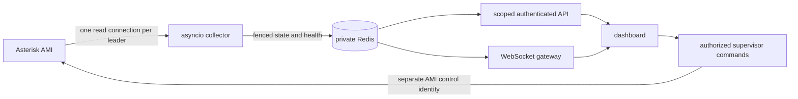

# SaneQueue real-time architecture

Status: integrated opt-in Redis/WebSocket beta.21, 2026-10-25. The existing Flask UI can now run behind the ASGI gateway with Redis-only ordinary reads. Legacy mode remains explicit for rollback. See [deployment](REALTIME_DEPLOYMENT.md) and [current audit](AUDIT_BETA21.md). This is not a production certification.

## Stack and process boundaries

Retain Python 3.10–3.12 and the working Flask application during migration. Use `asyncio` for the read-only collector, Redis for expiring shared state and leader fencing, the authenticated Starlette/a2wsgi/uvicorn WebSocket gateway, and PostgreSQL for the future application event/report database. Existing MariaDB CDR remains read-only. SQLite remains appropriate for a single-node pilot, not shared high-availability state.

```text
sanequeue/
  realtime/                 # IMPLEMENTED: independent of Flask and legacy imports
    protocol.py             # bounded AMI framing, one reader, ActionID correlation
    state.py                # queue members, waiting entries, channel legs, bridges
    collector.py            # leader session, heartbeat, reconnect, reconcile
    store.py                # Redis lease, fenced publish, TTL, stale detection
    config.py               # private configuration, verified TLS option
    __main__.py             # daemon and sanitized Redis-only status CLI
  api/                      # IMPLEMENTED: Redis-only scoped projections
  actions/                  # IMPLEMENTED: separate control identity, durable command lifecycle
  gateway/                  # IMPLEMENTED: authenticated WebSocket push and bounded sends
  history/                  # LATER: queue_log/CDR import and reporting
qpanel/                     # existing application; staged replacement, legal lineage retained
deploy/sanequeue-collector.service
samples/collector.ini.example
requirements/collector.txt
tests/test_realtime_engine.py
tests/test_realtime_redis.py
```

`api/`, `actions/`, `gateway/`, `alerts/` and `security/` now contain working implementation. History remains the later reporting phase. SQLite WAL holds single-node commands, session revocation and optional notification outbox.



## Implemented collector guarantees

- One elected leader per `pbx_id`; standby processes do not connect to AMI. A Lua ownership check fences every state publication. Losing renewal cancels connection/login as well as an established session. This limits duplicates during network partitions; it cannot provide an instantaneous physical singleton across arbitrary process freezes.
- A single connection carries Login, QueueStatus, optional CoreShowChannels, Ping and allowlisted read-only inventory actions. Its encoder rejects mutating actions and CR/LF/NUL injection. The test installation now uses a dedicated loopback read identity; supervisor commands use a separate short-lived connection with an independent identity. Optional inventory is partial when action permissions are unavailable.
- QueueStatus/CoreShowChannels run on startup, reconnect and reconciliation (default 120 seconds), not on viewer requests. Ping is default 10 seconds. Reload requests a resync with a five-second minimum interval.
- Events arriving during snapshots enter a bounded journal. QueueParams sequence barriers avoid replaying aggregate completions already represented by that response. AMI snapshots are not atomic transactions; `snapshot_atomic=false` remains explicit and periodic reconciliation is required.
- Reconnect uses exponential backoff with jitter, capped at 30 seconds. All request futures settle on timeout/disconnect. Transport cleanup is bounded. Event/frame/state/journal/payload budgets fail closed and resynchronize instead of allocating indefinitely.
- Publications coalesce at one second by default. Lease 15 seconds, health TTL 15 seconds, state TTL 30 seconds. The publisher refreshes health even when state has not changed. A generation mismatch, missing state, incomplete sync or missing health is stale. API/gateway consumers must fail closed when Redis is unavailable; they must never fall back to AMI polling.
- Redis change notifications carry generation/revision only. Pub/Sub is not a durable event log: consumers must read the latest full snapshot after reconnect or missed revisions.

## Asterisk edge cases and KPI contracts

`QueueCallerLeave` removes a waiting entry, not the channel. Only Hangup ends that channel leg; another leg may survive transfer. Uniqueid identifies a leg; Linkedid is an association, not a universally reliable business-call ID. Local members and actual SIP/PJSIP channels remain distinct. Bridge switches clean old membership; late leave events cannot detach a newer bridge. Rename replaces the channel index. Ring-no-answer is not abandonment. Re-entry into the same queue starts a fresh counter episode even when Uniqueid is reused.

Member device activity, paused state and ready state are separate. `InCall=1` is not overwritten by AgentCalled. ONHOLD has priority over InCall in presentation. Wrap-up expires without needing another AMI event, but only when LastCall and Wrapuptime exist. Unknown values stay unknown. LastCall, pause and observed-state timestamps are different concepts.

QueueParams SLA/performance, Holdtime and TalkTime are PBX summaries at their snapshot time; incremental completion counts do not make those averages current. AgentComplete HoldTime is queue waiting time, not time spent placing an answered call on hold. The new engine does not invent AHT, ASA/AWT, abandonment denominator or historical completeness. Accurate windowed metrics require the later queue_log event ledger, an explicit short-abandon policy and timezone. Active `held_since` is observational and is not a cumulative hold metric.

CoreShowChannels can inventory active legs but does not reconstruct every bridge or answered call's originating queue after reconnect. `initial_call_scope_complete=false` and `history_complete=false` are intentional. Unattributed legs must remain hidden from scoped users; never guess permissions from caller number, extension prefixes or Linkedid alone. The collector's entire Redis payload is private, not a browser response.

## Integrated gateway and command boundaries

Ordinary HTTP and WebSocket projections read Redis only. Scope and caller redaction are applied before serialization. The actual Flask login/session pipeline runs on every push; a shared hashed-token registry invalidates existing sockets after logout. Origin is explicit. Client action frames are refused. Full snapshots coalesce every two seconds; bounded connections, payloads and send deadlines prevent unbounded per-viewer queues. Redis failures never cause a hidden AMI fallback.

Control targets are revalidated from fresh scoped state and a server-owned internal extension allowlist. Exact Local halves and observed bridges propagate queue provenance; Linkedid is not an authorization boundary. Transferred SIP/PJSIP endpoints remain targets even after queue membership ends. SQLite serializes staffing reservations and records pending/confirmed/rejected/unknown commands. State confirmation does not establish causation or audio. Optional Bale outbox delivery is leased, bounded and at least once.

Run one gateway process. HA, full historical reporting, independent penetration review, broad PBX VM acceptance and high-call-volume soak testing remain future acceptance gates. Follow the [bilingual deployment/rollback guide](REALTIME_DEPLOYMENT.md); stopping Redis is not a legacy fallback.

Cancellation-race context: [CPython issue 86296](https://github.com/python/cpython/issues/86296). The collector uses an explicit deadline helper and regression tests rather than depending on race-sensitive `wait_for` behavior across supported Python versions.

Sources: [Asterisk QueueMemberStatus](https://docs.asterisk.org/Asterisk_21_Documentation/API_Documentation/AMI_Events/QueueMemberStatus/), [AMI event reference](https://docs.asterisk.org/Latest_API/API_Documentation/AMI_Events/), [Redis expiration semantics](https://redis.io/docs/latest/commands/expire/).
