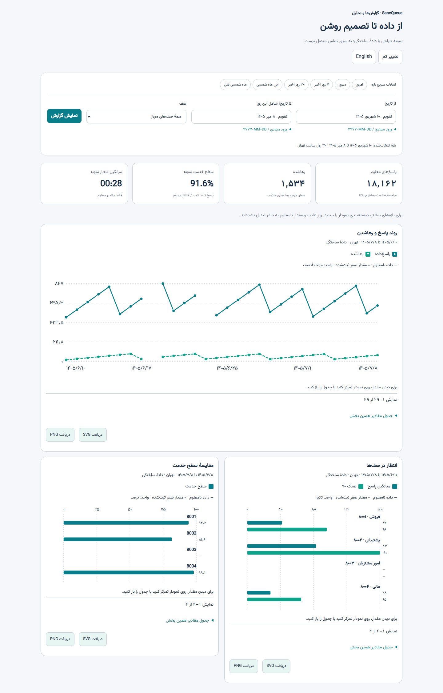

# راهنمای کاربردی گزارش‌گیری SaneQueue

این راهنما برای شاخهٔ `feature/reporting-phase2` است. امکانات قابل مشاهده به نقش کاربر، مجوز صف، پوشش داده و نسخهٔ نصب‌شده وابسته‌اند. [راهنمای نصب پایلوت](PILOT_BETA27.fa.md) و [محدودیت‌های باز](REPORTING_COMPLETION_CHECKLIST.fa.md) را نیز بخوانید.

*تصویر نمونهٔ آزمایشی است؛ اطلاعات آن واقعی نیست و ممکن است با نسخهٔ نصب‌شده تفاوت داشته باشد.*

## ۱. انتخاب گزارش و بازه

۱. از منوی «گزارش‌ها و تحلیل» یکی از دو گروه «گزارش مرکز تلفن» یا «گزارش مرکز تماس و صف» را باز کنید. برای خروجی و برنامه‌ریزی، گروه «خروجی‌ها و ابزارهای گزارش» را باز کنید.
۲. تاریخ شروع، تاریخ پایان و در صورت لزوم صف را در فیلتر بالای صفحه انتخاب کنید و «نمایش گزارش» را بزنید. تاریخ‌های نمایش‌داده‌شده شامل روز پایان هستند و محاسبه با منطقهٔ زمانی تهران انجام می‌شود.
۳. در بخش موردنظر دکمهٔ محاسبه را بزنید. عنوان و توضیح آن بخش را بخوانید: برخی بخش‌ها فیلتر مخصوص خود را دارند و فیلتر نتیجهٔ عمومی بر همهٔ آن‌ها اعمال نمی‌شود.
۴. اگر جدول خالی است، ابتدا بازه، صف مجاز، وضعیت جمع‌آوری و پوشش منبع را بررسی کنید. خط تیره یعنی مقدار نامعلوم است؛ نبود داده به معنی صفر بودن تماس واقعی نیست.

## ۲. گزارش‌های صف

### خلاصه و مقایسهٔ صف‌ها

مسیر: **گزارش مرکز تماس و صف ← خلاصه و مقایسه صف‌ها**. تعداد ورودهای مشاهده‌شده، پاسخ‌ها و نتیجه‌های هر صف را برای بازهٔ انتخابی مقایسه کنید. یک تماس که وارد دو صف شود دو «مراجعه» دارد؛ جمع مراجعه‌ها لزوماً تعداد تماس یا مشتری یکتا نیست. برای دریافت تعداد شماره‌های یکتا، «محاسبهٔ شماره‌های یکتا» را بزنید؛ شمارهٔ نامعلوم در شمارش یکتا قرار نمی‌گیرد.

### مراجعه‌های پاسخ‌داده‌شده

مسیر: **مراجعه‌های پاسخ‌داده‌شده ← محاسبه گزارش**. خلاصه، تفکیک صف و روز و نمودارهای ساعتی، روزانه و هفتگی نشان داده می‌شوند. «نمایش ریز مراجعه‌ها» ردیف‌ها را صفحه‌به‌صفحه باز می‌کند. برای فایل ثابت، قالب CSV، Excel یا PDF را انتخاب کنید و «ساخت خروجی در پس‌زمینه» را بزنید. مراجعهٔ منتقل‌شده فقط با شواهد اتصال در گروه پاسخ قرار می‌گیرد؛ زمان نامعلوم در میانگین صفر حساب نمی‌شود.

### مراجعه‌های بدون پاسخ و زنگ داخلی بدون پاسخ

مسیر: **مراجعه‌های بدون پاسخ ← محاسبه گزارش**. نتیجه‌ها، بر اساس رویداد ثبت‌شده، از جمله انصراف، پایان زمان انتظار، خروج با کلید و خروج صف خالی تفکیک می‌شوند. خروج صف خالی به‌تنهایی اثبات غیبت کارشناس نیست. ریز و خروجی پس‌زمینه مانند گزارش پاسخ‌داده‌شده در دسترس است.

مسیر جداگانهٔ **زنگ داخلی بدون پاسخ** پیشنهادهای زنگ ثبت‌شده برای عضو صف را نشان می‌دهد. یک مراجعه ممکن است چند بار به چند عضو پیشنهاد شود؛ بنابراین تعداد این رویدادها با تعداد تماس رهاشده یا مشتری ازدست‌رفته یکسان نیست. بازهٔ این گزارش حداکثر ۳۱ روز است.

### روندها و سطح خدمت

مسیر: **روندها و تحلیل صف**. گروه‌بندی زمانی و هدف پاسخ را تعیین کنید؛ مبنای سطح خدمت را نیز انتخاب کنید و «محاسبهٔ تحلیل» را بزنید. نمودار روند و جدول عدد دقیق را نشان می‌دهند. برای مقایسهٔ دو دوره، بازه، صف، هدف و مخرج را یکسان بگیرید. سطح خدمت بر اساس مخرج انتخابی تعریف می‌شود؛ تعریف آن را با آمار محصول دیگر یکسان فرض نکنید.

### مراجعه‌ها، صوت و مسیر

مسیر: **مراجعه‌های صف و صوت مرتبط**. برای یافتن تماس، بازه و صف را محدود کنید و در جدول، ردیف و جزئیات مجاز را باز کنید. پخش یا دانلود ضبط فقط وقتی نمایش داده می‌شود که فایل، مالکیت تماس و مجوز آن قابل اثبات باشد. نبود دکمه لزوماً به معنی ضبط‌نشدن تماس نیست. مسیر، انتقال و طرف قطع‌کننده فقط در حد شواهد موجود نمایش داده می‌شوند؛ پس از انتقال ممکن است قطع‌کنندهٔ نهایی نامعلوم بماند.

## ۳. کارشناس، حضور و شیفت

### عملکرد و رتبه‌بندی

مسیر: **عملکرد کارشناسان** برای پاسخ‌ها و زمان‌های قابل انتساب در هر صف؛ مسیر **مقایسه و رتبه‌بندی کارشناس** برای انتخاب شاخص و حداقل نمونه است. «آخرین پاسخ ثبت‌شده در صف» آخرین زمان پاسخ مشاهده‌شدهٔ کارشناس در مراجعه‌هایی است که در بازه وارد آن صف شده‌اند؛ این عدد آخرین تماس بدون پاسخ یا خارج از صف نیست. تعداد پاسخ و میانگین زمان مکالمه دو مقایسهٔ متفاوت‌اند؛ هیچ‌کدام به‌تنهایی کیفیت یا رضایت مشتری را ثابت نمی‌کند. ردیف‌های بدون هویت معتبر نباید به کارشناس حدسی نسبت داده شوند.

در همان بخش می‌توان جمع‌بندی پس‌زمینهٔ حداکثر ۳۱ روز را ثبت و بعد از «بازخوانی کارها» دریافت کرد. [جزئیات سقف و مجوز](AGENT_BACKGROUND_REPORT.fa.md).

### حضور، توقف و زمان رسیدگی

مسیرهای **حضور و علت توقف** و **ریز تغییر وضعیت** زمان‌های مشاهده‌شده و دلیل ثبت‌شدهٔ توقف را نشان می‌دهند. زمان یکتای کارشناس عضو چند صف با اجتماع بازه‌های هم‌پوشان محاسبه می‌شود؛ زمان عضویت هر صف جداست و جمع آن‌ها می‌تواند بیشتر از زمان یکتا باشد. قطع جمع‌آوری به معنی حضور یا غیبت نیست.

در **زمان رسیدگی و اشغال**، ACW فقط از وضعیت صریح پس از تماس محاسبه می‌شود. اگر وضعیت یا پوشش لازم ثبت نشده باشد، مقدار نامعلوم می‌ماند. در **پایبندی و تأخیر شیفت** ابتدا برنامهٔ شیفت و هویت مرتبط باید ثبت شده باشد؛ نبود برنامه یا پوشش را با تأخیر قطعی اشتباه نگیرید.

### هپی‌کال و تماس هنگام توقف

از **هپی‌کال و نظرسنجی** دورهٔ کاری ثبت‌شده را بررسی کنید؛ از **تماس حین توقف** نوع تماس داخلی یا بیرونی را انتخاب و جمع‌بندی را محاسبه کنید. هر ردیف یک بخش CDR ثبت‌شده است و ممکن است با یک مکالمهٔ یکتا برابر نباشد. مدت بخش می‌تواند از پایان توقف عبور کند. برچسب توقف به‌تنهایی اثبات هدف تماس یا نتیجهٔ نظرسنجی نیست.

## ۴. گزارش مرکز تلفن و شماره‌های یکتا

مسیر: **گزارش مرکز تلفن ← ترافیک خطوط و CDR**. این بخش برای مدیر دارای منو و مجوزهای لازم در دسترس است. فیلترهای موجود را برای مبدأ، مقصد، طرف تماس، جهت، نتیجه، DID یا سایر مشخصات تکمیل کنید و گزارش را اجرا کنید. داده‌های مبدأ واقعی و شناسهٔ خروجی فقط وقتی نمایش داده می‌شوند که منبع شواهد کافی داشته باشد. ردیف CDR یک بخش تماس است؛ جمع بخش‌ها الزاماً تعداد یا مدت مکالمهٔ یکتا نیست.

«محاسبه شماره‌های یکتا» شمارهٔ مبدأ ثبت‌شده در بخش‌های ورودی را می‌شمارد. برای مثال، ده بخش ورودی با همان شماره در یک روز، یک شمارهٔ یکتا در آن روز محسوب می‌شود. شمارهٔ یکتا الزاماً شخص یکتا نیست و اعداد یکتای روزها را نباید برای به‌دست‌آوردن یکتای کل جمع کرد.

## ۵. ساخت و زمان‌بندی فایل

### گزارش‌ساز صف

مسیر: **خروجی‌ها و ابزارهای گزارش ← گزارش‌ساز**. صف‌های مجاز، ستون‌ها و در صورت نیاز حداکثر دو گروه را انتخاب و پیش‌نمایش را اجرا کنید. تعریف را با نام ذخیره کنید. برای فایل خصوصی پس‌زمینه قالب موردنظر را انتخاب کنید؛ سپس وضعیت و دانلود را در **خروجی‌های پس‌زمینه** ببینید. [راهنمای گزارش‌ساز صف](REPORT_BUILDER.fa.md).

### گزارش‌ساز مرکز تلفن

در بخش CDR، ستون‌ها و حداکثر دو گروه را انتخاب کنید. پیش‌نمایش حداکثر ۱۰۰ ردیف دارد؛ CSV فوری حداکثر ۵۰۰۰ ردیف است. برای فایل کامل در محدودهٔ سقف منابع، قالب پس‌زمینه را انتخاب کنید. PDF حداکثر ۱۰۰۰ ردیف، ۱۰۰ صفحه و ۸ مگابایت دارد. فایل بالاتر از سقف ناقص منتشر نمی‌شود.

«زمان‌بندی همین گزارش» تعریف انتخابی را به فرم برنامه می‌برد. نام، دوره و ساعت تهران را تعیین و ذخیره کنید. فعال‌کردن تیک، اجرای دوره‌ای را فعال می‌کند؛ بدون آن برنامه دستی است. فیلترها و ستون‌ها ثابت می‌شوند، ولی دادهٔ CDR در آغاز پردازش هر نوبت خوانده می‌شود، نه هنگام ذخیرهٔ برنامه. روزهای خاموشی سرویس خودکار جبران نمی‌شوند. مجوزها هنگام اجرا و دانلود دوباره بررسی می‌شوند.

### نمودار و فایل

در نمودارهایی که دکمهٔ ذخیره دارند، PNG یا SVG تصویر همان نمودار را دریافت می‌کند. CSV/Excel/PDF موجود در یک بخش لزوماً خروجی همهٔ جدول‌های صفحه نیست؛ عنوان و محدودهٔ فایل را پیش از ارائه بررسی کنید. برای حفظ محرمانگی، فایل‌ها خصوصی و تابع مجوز جاری هستند.

## ۶. پیگیری، کیفیت و رضایت

**مراجعه پس از رهاشدن** مراجعهٔ بعدی همان شماره را در پنجرهٔ انتخابی بررسی می‌کند. دکمهٔ پیگیری می‌تواند وضعیت و یادداشت اعلامی کاربر را ثبت کند. مدیر مجاز می‌تواند یک بخش خروجی ثبت‌شده را به‌عنوان شاهد احتمالی متصل کند؛ تطبیق شماره یا پاسخ CDR به‌تنهایی ثابت نمی‌کند که این تماس برای همان پیگیری بوده است.

**کنترل کیفیت مکالمه** به مجوز و فرم تعریف‌شده نیاز دارد. **جست‌وجوی متن مکالمه** فقط متن موجود و مجاز را جست‌وجو می‌کند و وجود آن به معنای تبدیل‌شدن همهٔ ضبط‌ها نیست. نتایج نظرسنجی در بخش «صدای مشتری و رضایت» به فرم، پاسخ و منبع ثبت‌شده وابسته است؛ جمع‌آوری خودکار همهٔ انواع نظرسنجی هنوز کامل نیست.

## ۷. پرسش‌های متداول

| پرسش | پاسخ |
|---|---|
| چرا مجموع تعداد دو صف بیشتر از تماس‌هاست؟ | یک تماس می‌تواند وارد چند صف شود؛ واحد این گزارش مراجعه است. |
| چرا مجموع حضور دو صف از زمان کار بیشتر است؟ | عضویت هم‌زمان برای هر صف ثبت می‌شود؛ در حضور یکتا، هم‌پوشانی یک بار حساب می‌شود. |
| چرا شماره یا صوت نمی‌بینم؟ | مجوز، انتساب قابل اثبات و وجود داده یا فایل را بررسی کنید. |
| چرا میانگین خالی است؟ | ممکن است مدت معتبر یا پوشش کافی ثبت نشده باشد؛ خط تیره صفر نیست. |
| چه کسی تماس را قطع کرد؟ | نتیجه فقط به میزان شواهد پایان بخش قابل نمایش است؛ علت نهایی یا عمدی‌بودن قطع را از دادهٔ ناقص نتیجه نگیرید. |
| بازهٔ آمار چیست؟ | بازه و منطقهٔ زمانی انتخاب‌شده و توضیح هر گزارش را بررسی کنید؛ شاخص لحظه‌ای و تاریخی الزاماً یکسان نیستند. |

## ۸. مواردی که هنوز محدودیت دارند

جایگاه تاریخی ورود و خروج برای همهٔ مراجعه‌ها، زمان آخرین تماس جامع هر کارشناس فراتر از پاسخ‌های صف، انتخاب چند صف و چند کارشناس در همهٔ نماها، تحلیل کامل دلیل تماس، برخی خروجی‌های مستقل جدول‌ها و اثبات مسیرهای پیچیدهٔ انتقال هنوز تأیید یا تکمیل نشده‌اند. [فهرست دقیق شکاف‌ها و پذیرش باقی‌مانده](REPORTING_COMPLETION_CHECKLIST.fa.md). برای داده‌های واقعی، فایل ضبط، رمز و پایگاه داده را در مخزن عمومی منتشر نکنید.
