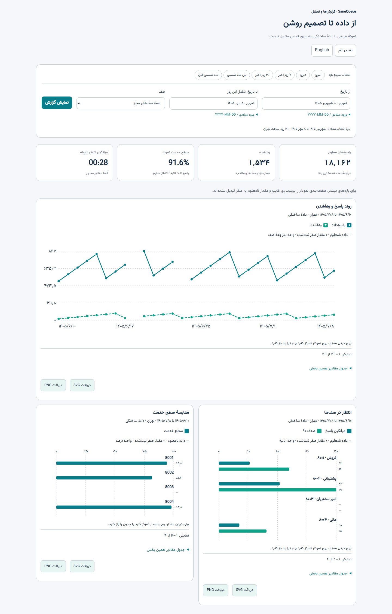

# راهنمای گزارش‌های SaneQueue

این راهنما وضعیت کد شاخهٔ توسعه را توضیح می‌دهد، نه تضمین سازگاری همهٔ نسخه‌های مرکز تلفن. منبع، بازه، صف‌های مجاز و پوشش داده را پیش از مقایسه بررسی کنید. مراجعه به صف، بخش CDR و مکالمهٔ یکتا واحدهای متفاوتی هستند و نباید تعدادشان را با هم جمع کرد.

*تصویر بالا نمونهٔ آزمایشگاه طراحی با دادهٔ ساختگی است؛ عکس دادهٔ مشتری یا تضمین ظاهر دقیق نسخهٔ نصب‌شده نیست.*

## شروع کار

۱. وارد پنل شوید و از «گزارش‌ها و تحلیل»، گروه «گزارش مرکز تلفن» یا «گزارش مرکز تماس و صف» را باز کنید. گزینهٔ انتخاب گزارش نیز در بالای صفحه در دسترس است.
۲. تاریخ شروع و پایان شامل همان روز، صف مجاز و در صورت نیاز نوع تماس را انتخاب کنید؛ «نمایش گزارش» را بزنید. تاریخ‌ها با منطقهٔ زمانی تهران پردازش می‌شوند. نتیجهٔ انتخابی فقط روی بخش‌هایی اثر دارد که در خود صفحه توضیح داده شده‌اند.
۳. در نمودار، واحد و بازه را بخوانید؛ جدول کنار یا زیر نمودار مقادیر دقیق را نشان می‌دهد. دکمه‌های PNG/SVG فقط تصویر نمودار را ذخیره می‌کنند. خط تیره یعنی اطلاعات معلوم نیست، نه صفر.
۴. برای خروجی مراجعه‌های صف از CSV/Excel یا «خروجی‌های پس‌زمینه» استفاده کنید. خروجی‌های پس‌زمینه به نقش و مجوز صف وابسته‌اند؛ پس از ساخت، وضعیت را بازخوانی و فایل را دریافت کنید. همهٔ انواع جدول خروجی مستقل Excel/PDF ندارند.

## تطبیق موارد درخواستی

| مورد | وضعیت و محل بررسی |
|---|---|
| پاسخ‌داده، رهاشده و ورودی هر صف | خلاصه و روند صف؛ ورودی شمارش مراجعه است و با مشتری یکتا فرق دارد. «از دست رفته» را با رهاشدن صف یا زنگ بی‌پاسخ داخلی یکسان فرض نکنید. |
| سطح خدمت | روندها و تحلیل صف؛ هدف ثانیه‌ای و مخرج انتخاب‌شده نمایش داده می‌شود. نبود زمان انتظار معلوم، نتیجه را نامعلوم می‌کند. |
| میانگین مکالمه و انتظار | روند و مقایسهٔ صف؛ متوسط به شواهد معتبر و محدودهٔ بخش صف وابسته است. |
| شماره، انتظار و جایگاه تماس‌گیرنده | مانیتور زنده شماره، انتظار و جایگاه جاری را نشان می‌دهد. تاریخچهٔ مراجعه شماره و انتظار را دارد؛ ثبت و نمایش جایگاه ورود/خروج تاریخی برای همهٔ رویدادها هنوز کامل تأیید نشده است. |
| مدت حضور، وضعیت و علت توقف کارشناس | حضور و علت توقف و ریز تغییر وضعیت؛ فاصلهٔ قطع جمع‌آوری مشاهده محسوب نمی‌شود. عضویت هم‌زمان در چند صف در زمان یکتای کارشناس دوباره شمرده نمی‌شود. |
| زمان آخرین تماس هر کارشناس | نمایش تاریخی جامع و مستقل برای همهٔ حالت‌ها در این بررسی تأیید نشده و باز است. |
| تعداد تماس و پاسخ کارشناس در هر صف | عملکرد کارشناسان در صف؛ انتساب به هویت معتبر نیاز دارد و موارد نامعلوم باید جدا بمانند. |
| قطع توسط کارشناس یا مشتری | پایان بخش صف از شواهد معتبر؛ قطع‌کنندهٔ نهایی مکالمه، به‌ویژه پس از انتقال، ممکن است نامعلوم باشد. |
| توزیع ساعتی، روزانه و هفتگی | روندها و تحلیل صف، با گروه‌بندی زمانی و نقشهٔ ساعت/روز؛ برای هر بازه و پوشش یکسان مقایسه کنید. |
| عملکرد صف‌ها و کارشناسان به تفکیک | خلاصهٔ صف‌ها و عملکرد کارشناسان؛ مقایسهٔ پس‌زمینه برای بازهٔ حداکثر ۳۱ روز در [راهنمای آن](AGENT_BACKGROUND_REPORT.fa.md) توضیح داده شده است. |

## بخش‌های گزارش

- **پاسخ‌داده و بدون پاسخ:** هر نمای مستقل را از منوی صف انتخاب و «محاسبه گزارش» را بزنید. جدول روز و صف و نمودار ساعت ورود از همان محدوده ساخته می‌شوند. بدون پاسخ چهار رویداد انصراف، پایان مهلت، خروج با کلید و خروج صف خالی را جدا می‌کند؛ زنگ بی‌پاسخ کارشناس گزارش جداگانه‌ای است. نرخ‌ها بر مبنای نتیجه‌های معلوم پاسخ‌داده و بدون‌پاسخ هستند؛ موارد باز و متناقض جدا می‌مانند. تعداد ورود نامعلوم در جمع قرار نمی‌گیرد. برای خروجی کامل ریز مراجعه‌های هر دسته، قالب CSV/Excel/PDF را انتخاب و «ساخت خروجی در پس‌زمینه» را بزنید؛ وضعیت و دریافت فایل در «خروجی‌های پس‌زمینه» است. خروجی هنگام ثبت، نسخهٔ ثابت تازه‌ای از داده می‌گیرد؛ دادهٔ دیررس می‌تواند اعداد را نسبت به نمایش قبلی تغییر دهد. PDF سقف جداگانه دارد. این خروجی ریز مراجعه است، نه خروجی مستقل هر جدول تجمیعی؛ نمایش ریز صفحه‌بندی‌شده در همین نما هنوز تکمیل نشده است. سقف هر محاسبه ۵۰هزار مراجعه و هم‌زمانی یک محاسبه در هر فرایند وب است.
- **شماره‌های یکتا:** در «خلاصه و مقایسهٔ صف‌ها»، «محاسبهٔ شماره‌های یکتا» را بزنید. مجموع کل، تفکیک روزانه و تعداد مراجعه‌های با شمارهٔ معتبر نشان داده می‌شود. اگر یک شماره در یک روز ده بار وارد صف شود، برای آن روز یک شماره و ده مراجعه است. روزها و صف‌ها را برای محاسبهٔ مجموع یکتا با هم جمع نکنید. شمارهٔ نامعلوم و ورودِ نامعلوم جدا شمارش می‌شوند. اختلاف قالب پیش‌شمارهٔ کشور ادغام نمی‌شود؛ شمارهٔ مشترک هویت یک شخص را ثابت نمی‌کند. این بخش فقط مراجعه‌های صف را پوشش می‌دهد و به مجوز مشاهدهٔ شمارهٔ همهٔ صف‌های انتخاب‌شده و نقش مدیر یا سرپرست نیاز دارد. سقف تعاملی ۵۰هزار مراجعه است؛ برای حجم بیشتر بازه یا صف را محدود کنید.
- **مرکز تلفن:** بخش‌های CDR، جهت ورودی/خروجی/داخلی و شواهد ترانک و DID؛ دسترسی و اطلاعات قابل اتکا وابسته به منبع CDR و مجوز است. هر ردیف یک بخش است.
- **مرکز تماس و صف:** مقایسهٔ صف‌ها، روند و سطح خدمت، مراجعه و صوت مرتبط با صف، کارکرد کارشناسان، حضور و توقف، زنگ بی‌پاسخ، شیفت، تماس حین توقف و دوره‌های هپی‌کال. ضبط و مسیر تماس فقط با مالکیت و مجوز قابل اثبات در دسترس‌اند.
- **ابزارها:** گزارش‌ساز مراجعهٔ صف و بخش‌های CDR، خروجی پس‌زمینه، قالب و زمان‌بندی، کنترل کیفیت و جست‌وجوی متن مجاز. خروجی Excel/PDF اختصاصی جمع‌بندی ماهانه هنوز کامل نیست.
- **تحلیل‌های اختیاری:** نظرسنجی مشتری، تحلیل صوت و متن به منبع، سرویس و پیکربندی مجاز نیاز دارند؛ گزینهٔ قابل تنظیم به معنی فعال یا آزموده‌شدن در همهٔ محیط‌ها نیست.

## خواندن درست و عیب‌یابی

اگر گزارشی خالی است، ابتدا بازه، صف، دسترسی کاربر، فعال‌بودن سرویس گزارش و پوشش منبع را بررسی کنید. اگر هویت یک داخلی با شواهد تاریخی مشخص نباشد، در جمع‌بندی پس‌زمینه تعداد مراجعه‌های نامشخص اعلام و از مقایسه کنار گذاشته می‌شود. مقایسهٔ تعداد پاسخ یا کوتاهی مکالمه، به تنهایی امتیاز کیفیت فرد نیست.

برای نصب و منابع به [راهنمای پایلوت](PILOT_BETA27.fa.md) و برای محدودیت‌های باز به [وضعیت توسعه](DEVELOPMENT_STATUS.fa.md) مراجعه کنید. اطلاعات شخصی، فایل صوتی و پایگاه واقعی را در مخزن عمومی بارگذاری نکنید.

## مرجع مقایسه

تصاویر مرجع ارائه‌شده نشان‌دهندهٔ فیلترها، نمودارهای توزیع، تماس‌های پاسخ‌داده و بی‌پاسخ و خروجی‌ها هستند؛ آن‌ها به تنهایی اثبات تمام ویژگی‌های پشت صحنه نیستند. جدول زیر وضعیت تطبیق قابلیت‌ها با کد جاری را مشخص می‌کند.

| قابلیت مشاهده‌شده در تصاویر ارسالی | وضعیت در این بررسی |
|---|---|
| ریز تماس همراه صوت، زمان و فیلتر | ریز مراجعهٔ صف و صوت وابسته به انتساب و مجوز وجود دارد؛ ریز CDR مستقل از صف است و برای همهٔ CDRها دسترسی به صوت اثبات نشده است. |
| جدول و نمودار کارشناس و مقایسه | عملکرد صف، رتبه‌بندی و نمودار وجود دارد؛ نمرهٔ کلی کیفیت/رضایت خودکار معادل تصویر تأیید نشده است. |
| انتخاب چند صف و چند کارشناس | بعضی گزارش‌ها از همهٔ صف‌های مجاز یا یک صف استفاده می‌کنند؛ انتخاب دلخواه چندصفی و چندکارشناسی به‌صورت یکپارچه برای همهٔ گزارش‌ها کامل تأیید نشده است. |
| تماس‌های توزیع‌شده، پاسخ‌داده و بی‌پاسخ به تفکیک زمان | روند و زنگ بی‌پاسخ موجود است؛ همهٔ جدول‌ها و نمودارهای مجزای تصاویر و خروجی هرکدام را نباید کامل‌شده فرض کرد. |
| ثبت «دلیل تماس» و تحلیل آن در ساعت/روز | گردش کار کامل ثبت دستهٔ دلیل مکالمه و نمودارهای اختصاصی آن در این بررسی تأیید نشده و باز است؛ علت توقف کارشناس همان دلیل تماس مشتری نیست. |
| خروجی‌ها و دانلود نمودار | خروجی مراجعهٔ صف و PNG/SVG نمودارها موجود است؛ خروجی CSV/Excel/PDF جداگانه برای تک‌تک جدول‌ها و جمع‌بندی کارشناس کامل نیست. |
| شاخص‌های تماس خروجی و تلاش تا پاسخ | بخش تماس‌های حین توقف و دورهٔ کاری قابل بررسی است؛ داشبورد جامع نرخ مؤثر/تلاش تا موفقیت برای همهٔ تماس‌های خروجی تأیید نشده است. |
| علت قطع و مسیر انتقال | شواهد بخش صف و مسیر قابل‌اثبات نمایش داده می‌شود؛ علت نهایی، کنفرانس و انتقال چندمرحله‌ای ممکن است نامعلوم بمانند. |
| بازگشت مشتری در پنجرهٔ مشخص و FCR | مراجعهٔ مجدد پس از رهاشدن بررسی می‌شود؛ FCR برای همهٔ تماس‌ها و ادعای حل قطعی مشکل مشتری تأیید نشده است. بازنگشتن تماس به خودی خود اثبات حل مشکل نیست. |
| سهم کارشناس در SLA و روند هفتگی هر کارشناس | SLA صف و مقایسهٔ کارشناس وجود دارد؛ نمایش کامل سهم هر کارشناس و نمودار هفتگی اختصاصی او در این بررسی تأیید نشده است. |

نمودارهای گزارش پاسخ‌داده و بدون پاسخ، علاوه بر ساعت ورود، روند روزانه و مجموع روزهای هفته را برای بازه و صف انتخابی نشان می‌دهند. روز هفته از تاریخ محلی ثبت‌شدهٔ مراجعه محاسبه می‌شود؛ دادهٔ ثبت‌نشده به معنی اثبات نبود تماس در منبع نیست.

در گزارش‌های پاسخ‌داده و بدون پاسخ، دکمهٔ «نمایش ریز مراجعه‌ها» صفحه‌ای از مراجعه‌های همان دسته را با صف، شماره مطابق مجوز، کارشناس، نتیجه و زمان‌ها نمایش می‌دهد. صفحهٔ بعد از آرشیو جاری خوانده می‌شود و با تغییر فیلتر پاک می‌شود؛ برای خروجی ثابت از خروجی پس‌زمینه استفاده کنید.

نمودار میانگین زمان انتظار و، برای مراجعه‌های پاسخ‌داده‌شده، میانگین زمان مکالمه برحسب ساعت ورود فقط از نمونه‌های دارای مدت ثبت‌شده استفاده می‌کند؛ مقدار نامعلوم صفر محسوب نمی‌شود.

گزارش‌ساز صف می‌تواند خروجی PDF سفارشی ریز یا گروه‌بندی‌شده را نیز در پس‌زمینه بسازد و زمان‌بندی کند. ستون‌ها و گروه‌بندی نسخهٔ ذخیره‌شده ثابت می‌مانند. سقف PDF هزار ردیف، صد صفحه و هشت مگابایت است؛ هنگام عبور از سقف یا لغو دسترسی خروجی ناقص منتشر نمی‌شود. قالب‌های گروهی حداکثر ۵۰۰ گروه دارند. زمان‌بندی مجوز جاری را هنگام اجرا مجدداً بررسی می‌کند.

در گزارش «ترافیک مرکز تلفن و خطوط»، مدیر دارای مجوز نمایش شماره می‌تواند شمارش شماره‌های یکتای ورودی را مستقل از صف اجرا کند. واحد شمارش، مبدأ ثبت‌شده در بخش CDR با جهت ورودی است؛ شماره یکتا به معنی مشتری یا مکالمه یکتا نیست. اعداد روزانه با هم جمع‌پذیر نیستند؛ شماره نامعلوم و جهت نامعلوم جدا هستند یا در شمارش وارد نمی‌شوند. فیلترهای CDR به جز جهت بر محاسبه اثر دارند. بالاتر از ۵۰ هزار بخش، درخواست رد می‌شود و نتیجهٔ ناقص نمایش داده نمی‌شود. سرشمارهٔ DID در جدول تجمیعی نیز در صورت نداشتن مجوز شماره پوشانده می‌شود.

در پیگیری مراجعهٔ رهاشده، تغییر فیلتر یا خروج از صفحه درخواست قبلی را لغو و داده‌های نمایش‌داده‌شده را پاک می‌کند. مجوز صف پس از پایان خواندن آرشیو دوباره بررسی می‌شود. نتیجهٔ مراجعهٔ بعدی با همان شماره به‌تنهایی اثبات تماس خروجی کارشناس نیست.

در «مراجعهٔ مجدد پس از رهاشدن»، دکمهٔ پیگیری هر ردیف امکان ثبت وضعیت اعلامی تلاش، ارتباط، بدون پاسخ یا مختومه را با یادداشت و شناسهٔ ثبت‌کننده فراهم می‌کند. برای مشاهده یا ثبت تاریخچه، سرپرست باید مجوز نمایش شمارهٔ همان صف را داشته باشد. تاریخچه قابل ویرایش یا حذف از پنل نیست و آخرین ۱۰۰ اقدام نمایش داده می‌شود. این اطلاعات اعلام کاربر است و وجود آن به‌تنهایی اثبات تماس خروجی یا پاسخ مشتری نیست.

برای مدیر کل دارای دسترسی همهٔ صف‌ها و نمایش شماره، کنار هر اقدام «شواهد خروجی» می‌تواند بخش‌های CDR خروجی به همان شماره را در پنجرهٔ انتخابی فهرست کند. مدیر یک مورد را به‌صورت دستی به اقدام متصل می‌کند؛ وضعیت، زمان و شناسهٔ رکورد در زمان ثبت به‌شکل تغییرناپذیر ذخیره می‌شوند. تطبیق شماره یا پاسخ‌داده بودن CDR به‌تنهایی اثبات نمی‌کند تماس برای آن پیگیری بوده یا همان فرد پاسخ داده است. شواهد فقط از دادهٔ ثبت‌شده و حداکثر ۵۰ گزینه استخراج می‌شوند و دسترسی سراسری مجدداً بررسی می‌شود.

### گزارش‌ساز مرکز تلفن (CDR)

در «ترافیک مرکز تلفن و خطوط»، ستون‌های دلخواه یا حداکثر دو گروه ترانک، جهت و نتیجه را انتخاب کنید و پیش‌نمایش بزنید. تاریخ از فیلتر بالای گزارش و سایر شرط‌ها از فرم CDR گرفته می‌شوند. ردیف واحدش بخش CDR است و تعداد یا مدت آن الزاماً تعداد یا زمان مکالمهٔ یکتا نیست. میانگین‌ها فقط مقادیر معلوم را شامل می‌شوند و مخرج نمونه نمایش داده می‌شود. پیش‌نمایش حداکثر ۱۰۰ ردیف نشان می‌دهد؛ CSV فوری حداکثر ۵۰۰۰ ردیف دارد. محدودیت دادهٔ منبع ۵۰ هزار بخش، ۵۰۰ گروه و ۸ مگابایت است؛ CSV فوری تا ۴ مگابایت و PDF تا ۱۰۰۰ ردیف، ۱۰۰ صفحه و ۸ مگابایت است. شماره‌ها مطابق مجوز پوشانده و فرمول‌های CSV خنثی می‌شوند. خروجی‌های CSV، Excel و PDF در صف پس‌زمینه ساخته می‌شوند. داده در شروع پردازش در یک تصویر ثابت خوانده می‌شود و ممکن است با پیش‌نمایش قبلی تفاوت داشته باشد؛ فیلترها در مرکز خروجی و فایل Excel/PDF درج می‌شوند.

برای زمان‌بندی، پس از انتخاب ستون‌ها و شرط‌ها، قالب را انتخاب کنید و «زمان‌بندی» را بزنید. نام، دوره و ساعت تهران را در فرم برنامه تعیین کنید. تعریف ستون‌ها و فیلترهای CDR هنگام ذخیره ثابت می‌شود و تاریخ هر نوبت طبق دورهٔ انتخابی تعیین می‌شود؛ داده‌ها هنگام شروع پردازش همان نوبت خوانده می‌شوند. این گزارش سراسر آرشیو CDR را پوشش می‌دهد و فقط برای مدیر دارای دسترسی لازم به همهٔ صف‌ها و منوهای گزارش و کاربران قابل اجراست. مجوزها هنگام اجرا و دانلود دوباره بررسی می‌شوند؛ فیلتر شماره دسترسی نمایش کامل شماره را لازم دارد.

در گزارش‌ساز CDR، نتیجهٔ گروهی تا ۱۰۰ گروه نمودار مقایسه‌ای دارد. اگر پیش‌نمایش کامل گروه‌ها را در بر نگیرد، نمودار ناقص به‌جای نمودار کامل نشان داده نمی‌شود.
