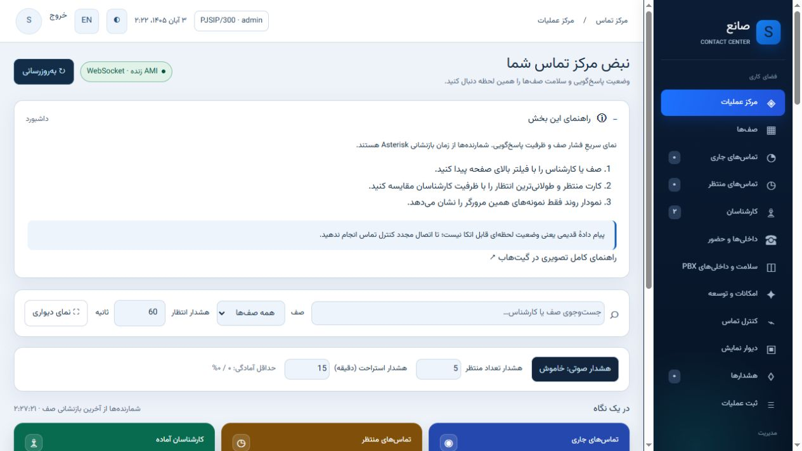
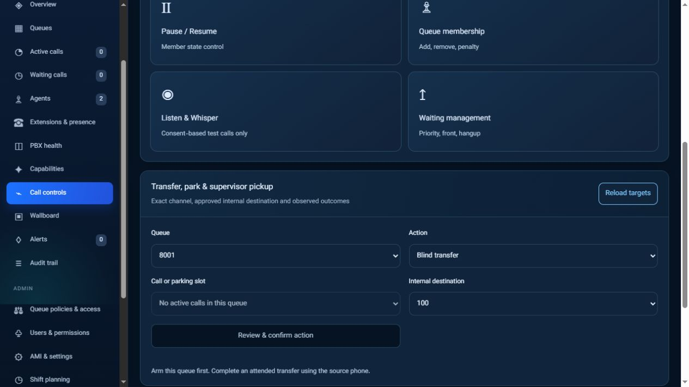
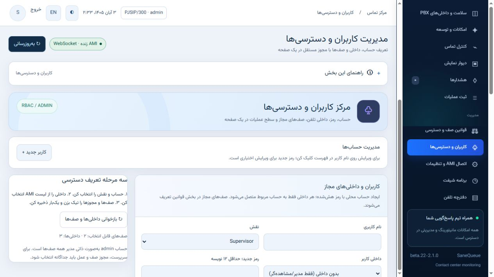
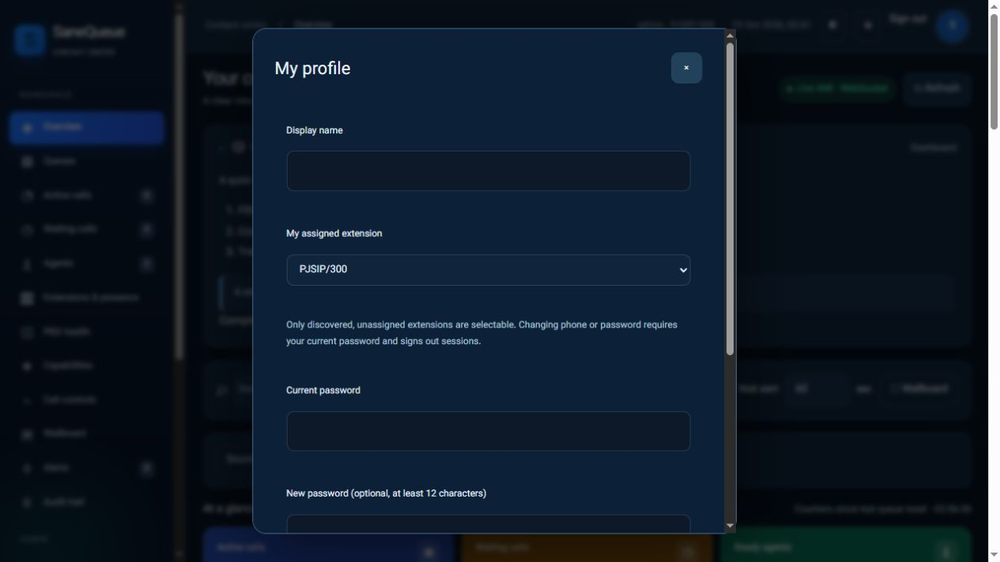

# راهنمای کاربردی SaneQueue

این راهنما با راهنمای داخل پنل از یک منبع ساخته می‌شود. اسکرین‌شات‌ها نمونهٔ رابط‌اند؛ آمار محیط شما متفاوت است.

## فهرست بخش‌ها

- [مرکز عملیات](#live)
- [صف‌ها](#queues)
- [تماس‌های جاری](#calls)
- [تماس‌های منتظر](#waiting)
- [کارشناسان](#agents)
- [داخلی‌ها و حضور](#presence)
- [سلامت PBX و ترانک‌ها](#pbx)
- [کنترل تماس سرپرست](#control)
- [دیوار نمایش](#wallboard)
- [هشدارها](#alerts)
- [ثبت عملیات](#audit)
- [تنظیمات و پیام‌رسان‌ها](#settings)
- [کاربران و دسترسی‌ها](#users)
- [قوانین صف](#policies)
- [برنامه شیفت](#shifts)
- [دفترچه تلفن](#directory)
- [قابلیت‌ها و محدودیت‌ها](#features)

## مرکز عملیات

نمای سریعِ فشار صف و ظرفیت پاسخ‌گویی. شمارنده‌ها از زمان بازنشانی Asterisk هستند.

1. صف یا کارشناس را با فیلتر بالای صفحه پیدا کنید.
2. کارت منتظر و طولانی‌ترین انتظار را با ظرفیت کارشناسان مقایسه کنید.
3. نمودار روند فقط نمونه‌های همین مرورگر را نشان می‌دهد.

> پیام دادهٔ قدیمی یعنی وضعیت لحظه‌ای قابل اتکا نیست؛ تا اتصال مجدد کنترل تماس انجام ندهید.

## صف‌ها

هر کارت، وضعیت صف، اعضا و هشدار همان صف را کنار هم نشان می‌دهد.

1. روی جزئیات صف بزنید تا شاخص‌ها و تعریف آن‌ها را ببینید.
2. SLA درصد پاسخ در مهلت تعیین‌شدهٔ خود Asterisk است.
3. میانگین انتظار و مکالمه مربوط به تماس‌های پاسخ‌داده‌شده‌اند.

## تماس‌های جاری

تماس‌ها را با کارشناس، صف و زمان مکالمه دنبال کنید.

1. صف را انتخاب و وضعیت تازگی داده را بررسی کنید.
2. برای عملیات، کارشناس یا تماس فعال را انتخاب کنید.
3. انتقال مستقیم مقصد را زنگ می‌زند؛ انتقال با مشورت ابتدا امکان صحبت با مقصد را می‌دهد.

> هر تماس می‌تواند چند کانال SIP/PJSIP/Local داشته باشد؛ تعداد کانال با تعداد مکالمه یکی نیست.

## تماس‌های منتظر

تماس‌های منتظر با جایگاه و مدت انتظار نمایش داده می‌شوند.

1. برای دیدن شمارهٔ کامل باید مجوز نمایش شماره داشته باشید.
2. افزایش اولویت ترتیب صف را تغییر می‌دهد؛ ظرفیت پاسخ‌گویی را بیشتر نمی‌کند.
3. قطع تماس فقط بعد از بررسی تماس انتخاب‌شده انجام شود.

## کارشناسان

آماده، زنگ‌خور، در مکالمه، توقف و پس از تماس از هم جدا هستند.

1. علت توقف را انتخاب و سپس توقف را ثبت کنید.
2. برای بازگشت به پاسخ‌گویی، ادامه را بزنید.
3. کارشناس فقط وضعیت خودش را تغییر می‌دهد؛ سرپرست به مجوز صف و عملیات نیاز دارد.

> شناسهٔ Local عضویت صف است؛ آن را با داخلی واقعی SIP یا PJSIP اشتباه نگیرید.

## داخلی‌ها و حضور

عضویت و وضعیت تلفنی داخلی‌ها را برای صف‌های مجاز ببینید.

1. یک داخلی ممکن است عضو چند صف باشد.
2. توقف در یک صف لزوماً به معنی توقف در همهٔ صف‌ها نیست.
3. Wrap-up زمان آماده‌سازی پس از تماس است و با آفلاین بودن فرق دارد.

## سلامت PBX و ترانک‌ها

داخلی‌ها، ترانک‌ها و مجوزهای AMI را بدون تغییر PBX بررسی کنید.

1. داخلی‌ها از ترانک‌ها جدا هستند، حتی اگر نام ترانک عددی باشد.
2. آداپتور محلی هر ۳۰ ثانیه فهرست را به‌روزرسانی می‌کند.
3. Unavailable با Unknown فرق دارد؛ Unknown یعنی دادهٔ کافی نداریم.

> RTT و افت بسته فقط با RTCP معتبر قابل نمایش‌اند؛ نبود داده را کیفیت خوب فرض نکنید. جیتر بدون نرخ ساعت کدک به میلی‌ثانیه تبدیل نمی‌شود.

## کنترل تماس سرپرست

کنترل تماس نیازمند داخلی اختصاصی سرپرست، مجوز صف و تماس زنده است.

1. شنود: سرپرست فقط صدای مکالمه را می‌شنود.
2. نجوا: صدای سرپرست باید فقط به کارشناس برسد؛ ورود به مکالمه برای گفت‌وگوی سه‌طرفه است.
3. پارک تماس را در جایگاه نگه می‌دارد؛ بازیابی آن را روی داخلی سرپرست می‌آورد.
4. Pickup برای تماسِ هنوز در حال زنگ‌خوردن است، نه مکالمهٔ پاسخ‌داده‌شده.

> پذیرفته‌شدن درخواست AMI، تأیید کیفیت صوت نیست. وضعیت unknown را بدون بررسی تماس دوباره ارسال نکنید.

## دیوار نمایش

نمای مناسب مانیتور بزرگ برای سرپرست و مدیر.

1. صف‌های موردنظر را انتخاب کنید و نمای تمام‌صفحه را بزنید.
2. با Escape از تمام‌صفحه خارج شوید.
3. در نمایش عمومی شماره‌ها پوشیده‌اند؛ شمارهٔ کامل فقط با مجوز و انتخاب نمای خصوصی سرپرست نمایش داده می‌شود.

## هشدارها

هشدارهای فعال و وضعیت ارسال پیام‌رسان‌ها را بررسی کنید.

1. برای تنظیم آستانه به قوانین صف بروید.
2. صدای مرورگر باید با کلیک کاربر فعال شود؛ محدودیت خود مرورگر است.
3. شمارندهٔ ارسال به معنی پذیرش توسط API پیام‌رسان است؛ گفت‌وگوی مقصد را نیز بررسی کنید.
4. برجسته‌سازی انتظار در نوار بالا فقط نمایش شخصی است؛ در نصب پایدار، هشدار صف و صدای آن از قوانین همان صف پیروی می‌کنند.

## ثبت عملیات

ردپای عملیات مدیریتی؛ این قسمت گزارش تاریخی عملکرد تماس نیست.

1. کاربر، صف، نوع عمل و نتیجه را کنار هم بررسی کنید.
2. فرمان pending هنوز نتیجهٔ نهایی ندارد.
3. برای فرمان unknown ابتدا وضعیت فعلی تماس را بررسی کنید.

## تنظیمات و پیام‌رسان‌ها

سلامت اتصال و پیام‌رسان‌ها از این بخش مدیریت می‌شوند.

1. نصب مدیریت‌شده، اتصال Collector را روی سرور می‌سازد.
2. ربات تلگرام یا بله را در حساب مقصد شروع کنید.
3. توکن و شناسهٔ عددی مقصد را ذخیره و یک پیام آزمایشی ارسال کنید.
4. برای هشدار واقعی، ارسال هر صف را در قوانین صف فعال کنید.
5. نام، عنوان و لوگوی سازمان را در هویت سازمان ذخیره کنید؛ صفحهٔ ورود نیز به‌روز می‌شود.
6. برای آزمایش روی سرور واقعی، غیرفعال‌کردن مانیتورینگ دریافت AMI و کنترل این ماژول را متوقف می‌کند؛ تماس‌های PBX ادامه دارند.
7. اگر پنل باز نیست: sudo sanequeuectl disable. برای بازگشت: sudo sanequeuectl enable. حذف سرویس‌ها با حفظ داده: sudo sanequeuectl uninstall --yes.

> خالی‌گذاشتن توکن، توکن قبلی را حفظ می‌کند. توکن را در اسکرین‌شات، تیکت یا مخزن عمومی قرار ندهید.

## کاربران و دسترسی‌ها

دسترسی از سه لایه تشکیل می‌شود: نقش، بخش‌های پنل، و مجوز صف/عملیات.

1. مدیر: کاربران و تنظیمات؛ سرپرست: عملیات مجاز صف؛ کارشناس: توقف/ادامهٔ خودش؛ مشاهده‌گر: فقط مشاهده.
2. داخلی واقعی را انتخاب کنید؛ یک داخلی به دو حساب اختصاص داده نمی‌شود.
3. منوهای موردنیاز، صف‌ها و عملیات را تیک بزنید و یک‌بار ذخیره کنید.
4. رمز جدید هنگام ویرایش اختیاری است؛ حداقل ۱۲ نویسه لازم دارد.

## قوانین صف

قواعد هر صف مستقل از صف‌های دیگر است.

1. مثال: برای شلوغی صف، آستانهٔ تعداد را روی ۵ تنظیم کنید.
2. برای انتظار طولانی، ۵ دقیقه را به صورت ۳۰۰ ثانیه وارد کنید.
3. تلگرام و بله را مستقل انتخاب کنید؛ فاصلهٔ ارسال، تکرار هشدار فعال را محدود می‌کند.
4. سقف خروج کارشناس به برنامهٔ نفرات و حداقل افراد حاضر وابسته است.

## برنامه شیفت

برنامهٔ حضور تیم؛ با ذخیرهٔ شیفت وضعیت تلفن خودکار تغییر نمی‌کند.

1. صف، کارشناس و زمان شروع/پایان را مشخص کنید.
2. تداخل شیفت‌ها را قبل از ذخیره بررسی کنید.
3. توقف و عضویت واقعی از بخش کارشناسان و کنترل صف انجام می‌شوند.

## دفترچه تلفن

دفترچهٔ مشترک مخاطبانِ مرتبط با صف‌های مجاز؛ برای ثبت نام، شماره و یادداشت کاری.

1. صف مربوط به مخاطب را مشخص کنید تا دسترسی همان صف رعایت شود.
2. نام و شماره را برای جست‌وجو و شناخت مخاطب ثبت کنید.
3. این دفترچه خودش تماس ایجاد نمی‌کند و جای CDR یا CRM کامل نیست.

## قابلیت‌ها و محدودیت‌ها

وضعیت واقعی قابلیت‌ها و محدودیت‌های هر بخش.

1. آماده یعنی قابلیت پیاده‌سازی شده؛ همچنان محیط شما باید پیش‌نیازهای آن را داشته باشد.
2. بتا نیازمند آزمون پذیرش در همان PBX است.
3. برنامهٔ توسعه به معنی قابلیت فعال و قابل استفاده نیست.

## پروفایل و رمز عبور

از دکمهٔ تصویر بالای پنل، نام، داخلی و عکس خود را مدیریت کنید. برای تغییر رمز یا داخلی، رمز فعلی را وارد کنید. با این تغییر، تمام نشست‌های قبلی حساب بسته می‌شوند. عکس PNG/JPEG/WebP حداکثر ۵۱۲ کیلوبایت و ۴ مگاپیکسل پذیرفته می‌شود و اطلاعات اضافی تصویر حذف می‌شوند.

## منابع اتصال پیام‌رسان

- [Telegram Bot API](https://core.telegram.org/bots/api#sendmessage)
- [Bale Bot API](https://docs.bale.ai/)
