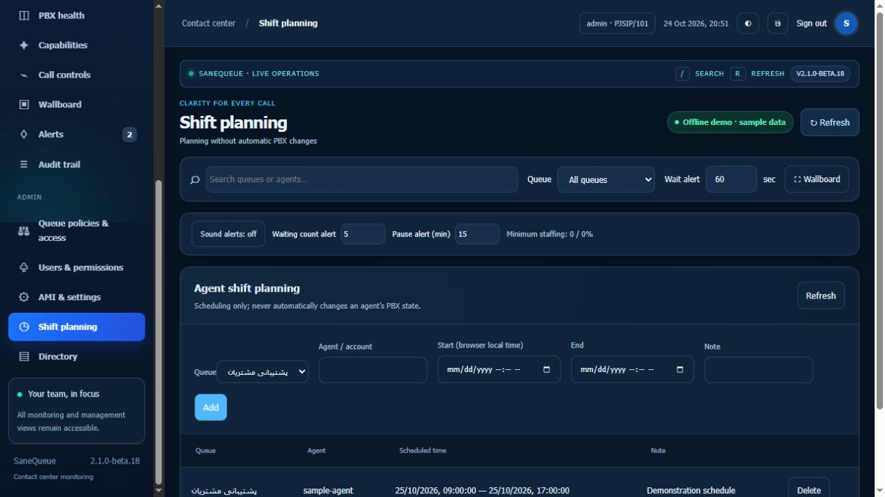

# User guide

1. Sign in with your own account. Switch language and appearance in the top bar.
2. Select queues and search callers/agents. Queue counters are since the last Asterisk reset; charts contain only samples observed by this browser.
3. Use Queues, Waiting calls and Agents for focused views. Busy memberships and channel legs are not necessarily unique calls.
4. Administrators configure account roles, assigned supervisor phones and queue grants in Users & permissions. Set readiness and alert thresholds per queue.
5. Before test controls, probe AMI, select the test queue and enable its temporary gate in AMI & settings. Read the result; accepted means pending independent verification.
6. For listen/whisper/barge, maintain a test conversation and answer the assigned supervisor phone. Verify who can hear whom before acceptance.
7. Shift planning records intended schedules without changing PBX state. Directory stores queue contacts; it does not dial them.

Do not use the capabilities catalogue's planned items as active controls. Historical reporting is deferred to the next phase. If AMI disconnects, the live server reports an error instead of showing demo data.
